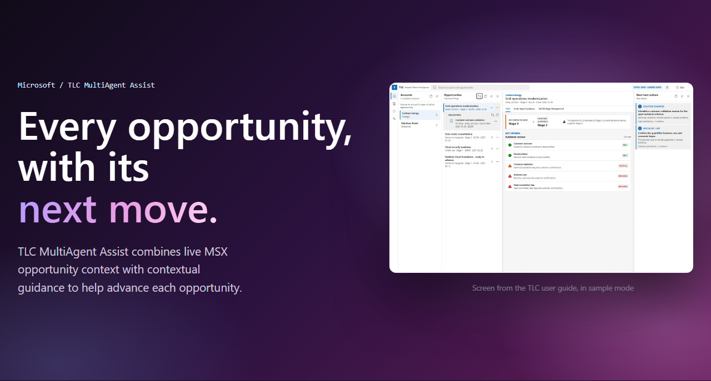
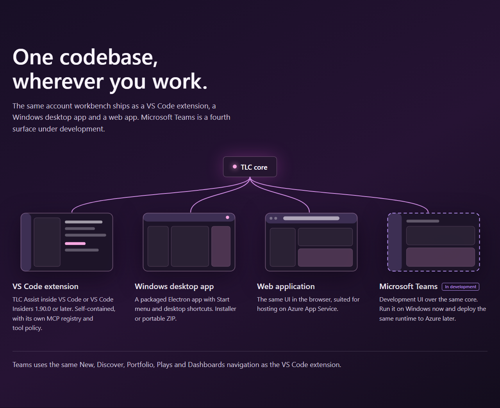
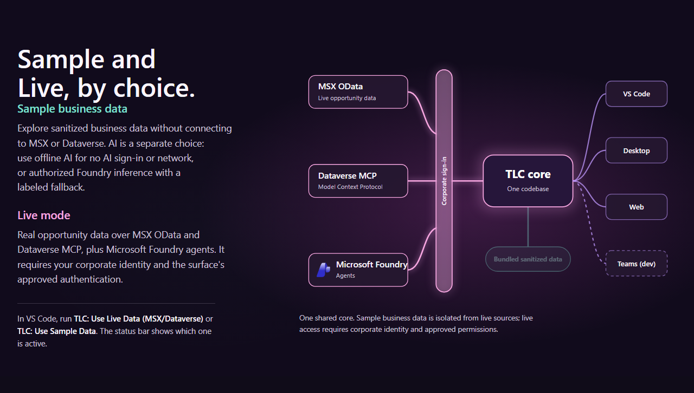
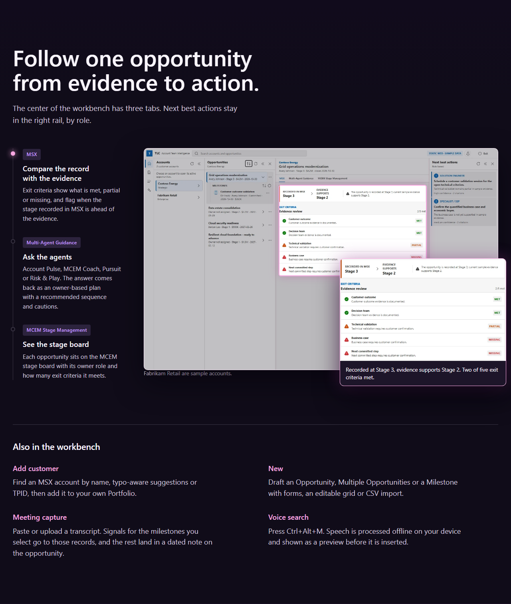
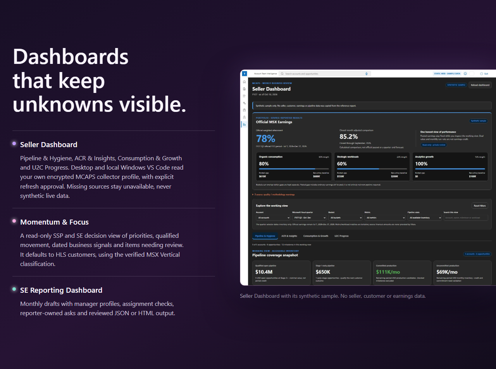
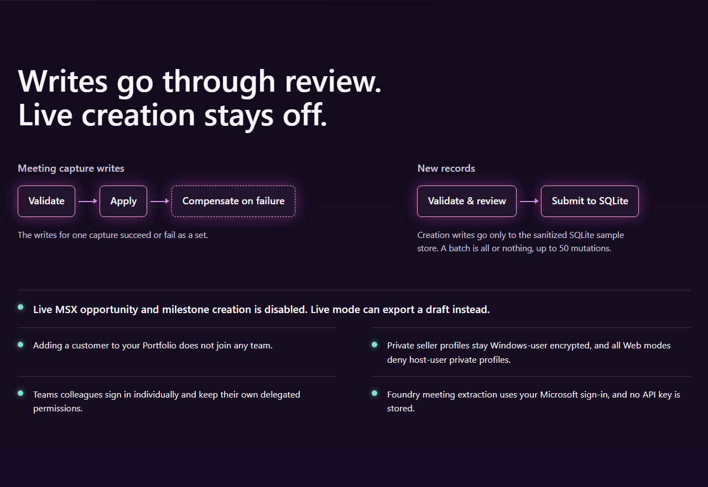

<p>
  <a href="#quick-install"></a>
  &nbsp;
  <a href="README-ORIGINAL.md"></a>
</p>

[Original README & full text guide](README-ORIGINAL.md) · [Surfaces](#surfaces) · [Sample & Live](#data-modes) · [Workbench](#workbench) · [Dashboards](#dashboards) · [Guardrails](#guardrails) · [Documentation](#documentation)

## Quick install

| Surface & requirements | Install and open | Full instructions |
| --- | --- | --- |
| <a id="vs-code-extension"></a>**VS Code extension**<br>VS Code or Insiders **1.90.0+**. No separate Node.js/npm install. | Download `tlc-assist-vscode-<version>.vsix` from [extension releases](https://github.com/kprpg/TLC-MultiAgentAssist/releases?q=extension). Run **Extensions: Install from VSIX...**, then **Developer: Reload Window**. Open **TLC Assist** or run **TLC: Open Assist**. | [Install guide](docs/user-guide/VSCODE-EXTENSION-INSTALL.md) |
| <a id="desktop-app"></a>**Windows desktop**<br>Windows **x64**. Installer or portable ZIP. | From [desktop releases](https://github.com/kprpg/TLC-MultiAgentAssist/releases?q=desktop), download `TLC-MultiAgent-Assist-<version>-Windows-x64.exe` and run setup. Alternatively, extract the portable `.zip` and run `TLC MultiAgent Assist.exe`. | [Install guide](docs/user-guide/DESKTOP-INSTALL.md) |
| <a id="web-application"></a>**Web application**<br>Local setup: **Node.js 22.12+**, **npm 10+**, port **8080** available. | Clone [this repository](https://github.com/kprpg/TLC-MultiAgentAssist). From its root, run `npm ci`, then `npm run web:start`. Open [localhost:8080](http://127.0.0.1:8080). This starts sample business data; see the notes below for offline AI. | [Web setup & hosting](docs/runbooks/web-app.md) |

<a id="microsoft-teams-under-development"></a>
**Microsoft Teams is under development**, not a production-ready fourth release. [Teams development guide](docs/runbooks/teams-app.md).

<details>
<summary><strong>Installation notes, upgrades and completely offline sample mode</strong></summary>

- **VS Code upgrades:** `.vsix` installs are not auto-updated. Reinstall a newer `tlc-assist-vscode-<version>.vsix`, then reload the window. [Update instructions](docs/user-guide/VSCODE-EXTENSION-INSTALL.md#updates).
- **Windows downloads:** verify this repository's GitHub Releases as the source before using **Properties > Unblock**, if needed.
- **Sample data and AI are independent.** Foundry AI uses network/sign-in by default, with a labeled offline fallback. For fully offline sample AI, use `tlc.aiMode=sample` in VS Code, or `$env:TLC_AI_MODE = 'sample'` before launching Desktop/Web. [Sample and AI options](docs/runbooks/sample-foundry-ai.md).
- **Desktop normally starts live**, with corporate sign-in. For offline sample data and AI, close any running instance and launch from PowerShell:

```powershell
$env:TLC_DATA_MODE = 'sample'
$env:TLC_AI_MODE = 'sample'
& "$env:LOCALAPPDATA\Programs\TLC MultiAgent Assist\TLC MultiAgent Assist.exe"
```

For a portable or all-users installation, replace the executable path. Live access requires corporate identity and approved source permissions.

</details>

<p>
  <a id="surfaces"></a>
  
  <a id="data-modes"></a>
  
  <a id="workbench"></a>
  
  <a id="dashboards"></a>
  
  <a id="guardrails"></a>
  
</p>

<a id="documentation"></a>
<details>
<summary><strong>Text guides, feature details and development</strong></summary>

- [Original README - complete, searchable reference](README-ORIGINAL.md)
- [End-user guide and workbench tour](docs/user-guide/USER-GUIDE.md)
- [Seller Dashboard](docs/user-guide/SELLER-DASHBOARD.md)
- [Momentum & Focus](docs/architecture/Momentum-Focus-Dashboard-Proposal.md)
- [SE Reporting Dashboard](docs/user-guide/SE-REPORTING-DASHBOARD.md)
- [Opportunity and Milestone creation](docs/user-guide/USER-GUIDE.md#new-opportunity-and-milestone-creation)
- [Sanitized CSV/JSON creation examples](tests/fixtures/record-creation/README.md)
- [Account discovery](README-ORIGINAL.md#account-discovery)
- [Voice search and privacy](docs/user-guide/VOICE-SEARCH.md)
- [Knowledge search setup and provider contract](docs/Knowledge-Search-Connectors.md)
- [Frequently asked questions](docs/FAQ.md)
- [Technology stack](TechStack.md)
- <a id="development"></a>[Build and run from source](README-ORIGINAL.md#development)
- [Release workflows](README-ORIGINAL.md#release-workflows)
- [Product backlog](docs/Product-Backlog.md)

</details>

<details>
<summary><strong>Build and release status</strong></summary>

[](https://github.com/kprpg/TLC-MultiAgentAssist/actions/workflows/ci.yml)
[](https://github.com/kprpg/TLC-MultiAgentAssist/actions/workflows/nightly.yml)
[](https://github.com/kprpg/TLC-MultiAgentAssist/actions/workflows/desktop-release.yml)
[](https://github.com/kprpg/TLC-MultiAgentAssist/actions/workflows/web-release.yml)
[](https://github.com/kprpg/TLC-MultiAgentAssist/actions/workflows/vscode-extension-release.yml)
[](https://github.com/kprpg/TLC-MultiAgentAssist/actions/workflows/nightly-vscode-extension.yml)

</details>

<p align="center">
  <a href="#quick-install">Choose your surface</a> &bull;
  <a href="README-ORIGINAL.md">Read the original README</a><br>
  <sub>Visual sections are static renders of the landing-page design. Use the original README for searchable, copyable details.</sub>
</p>
