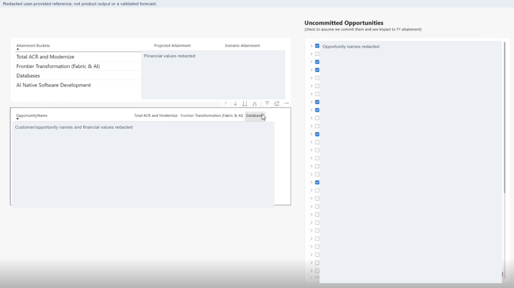
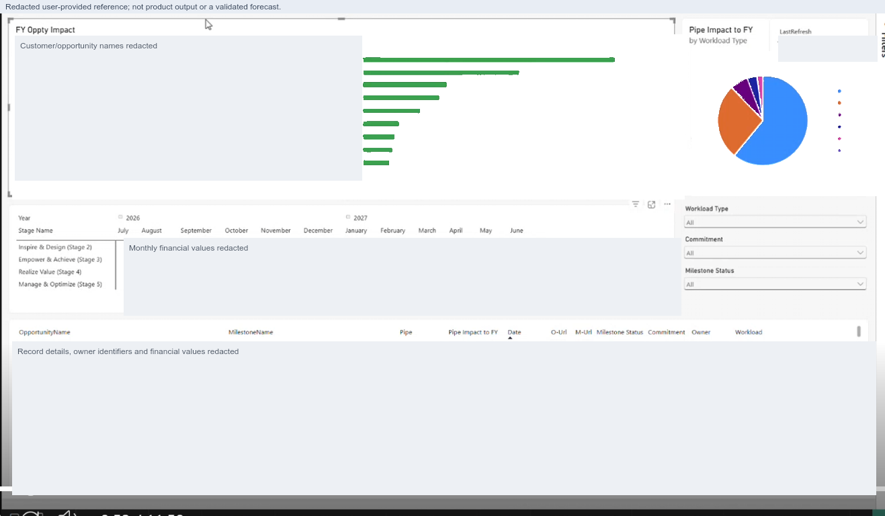
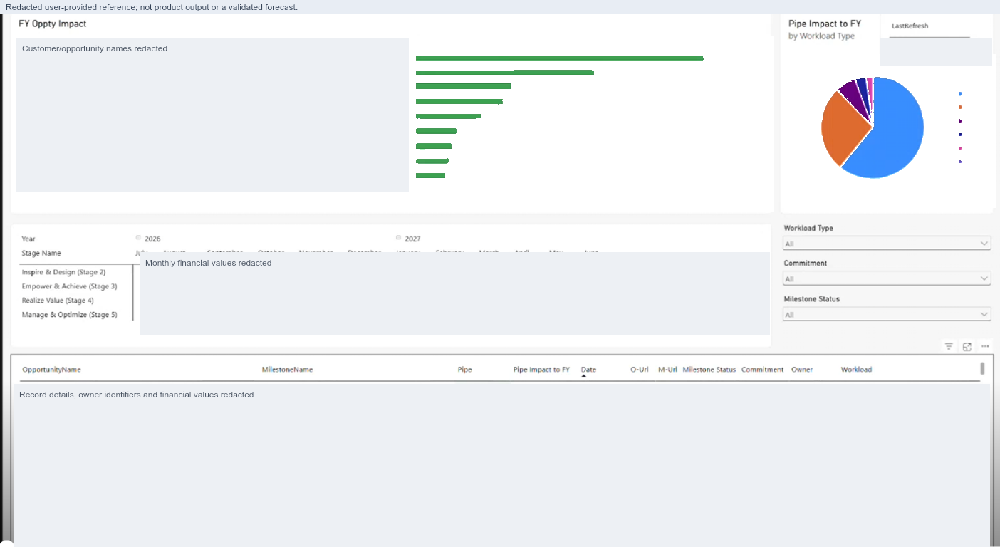
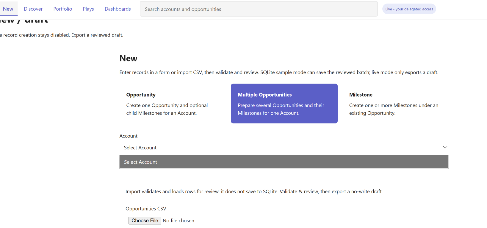
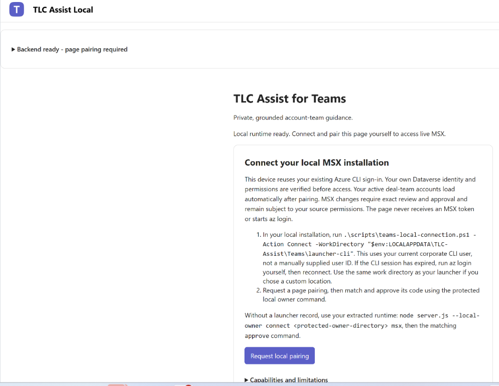

# Product Backlog

Feature requests, user feedback, ideas, and reported product issues for TLC MultiAgent Assist.

**Last updated:** 2026-10-20

> Intake and planning only. Recording an item does not approve its implementation,
> assign a delivery date, or establish that a capability exists. Acceptance criteria
> below are proposed unless a decision explicitly says otherwise.

## How to add a request

1. Assign the next unused `PB-NNN` ID. IDs are permanent and do not indicate priority.
2. Add a row to the register and copy the [entry template](#entry-template) into
   the appropriate area below. Keep its ID anchor unchanged if the title changes.
3. Capture the user's problem, desired outcome, affected surface, and evidence.
   Keep the original request distinguishable from proposed implementation ideas.
4. Add screenshots under [media/product-backlog](./media/product-backlog/), using
   names such as `PB-006-01-short-description.png`. Link them relative to this file.
   Redact customer names, record identifiers, personal information, financial values,
   tokens, and private links before adding an image to the repository.
5. During triage, set priority, owner, acceptance criteria, dependencies, and links
   to any issue, design, implementation task, or pull request. Update both the
   register and detailed entry when the status changes.

Do not replace or silently duplicate earlier items in [TLC follow-up work](./TODO.md).
Link related items and consolidate duplicates during triage.

### Status and priority

| Status | Meaning |
| --- | --- |
| New | Captured; not yet triaged. |
| Needs clarification | Required scope, evidence, data, or success criteria are missing. |
| Queued | Retained for follow-up; not actively being implemented. |
| Planned | Scope and ownership agreed; linked to an implementation task. |
| In progress | Implementation has actually started. |
| Blocked | A named dependency prevents progress. |
| Done | Agreed acceptance criteria have been verified; link the evidence. |
| Declined / Duplicate | Record the reason or link the surviving item; retain the ID. |

Priorities: **P0** critical, **P1** high, **P2** normal, **P3** low, or
**Untriaged**. Do not infer priority from the order of requests or a screenshot.

## Register

Initial requests were received in the current conversation on **2026-10-20**.
Reporter names were not recorded. All owners are **Unassigned** and priorities
are **Untriaged** until reviewed.

| ID | Request / issue | Area | Type | Surface | Status |
| --- | --- | --- | --- | --- | --- |
| [PB-001](#pb-001) | Where will I end the year based on what I currently know? | STU Planning | Feature | To be agreed | New |
| [PB-002](#pb-002) | Opportunity Impact / Pipe Impact to FY | STU Projections | Feature | To be agreed | New |
| [PB-003](#pb-003) | Which opportunities should I focus on? | STU Projections | Feature | To be agreed | New |
| [PB-004](#pb-004) | New: Select Account has no options | Record creation | Bug | Teams, under development | Queued |
| [PB-005](#pb-005) | Returning to TLC implies repeating setup | Connection guidance | UX feedback | Teams, under development | Queued |

## 1. STU Planning

<a id="pb-001"></a>

### PB-001 - Fiscal-year outlook and what-if planning

**Status:** New  
**User question:** "Where am I going to end up the year, based on what data I currently have/know?"

**Problem / value:** Users need an understandable year-end outlook and a way to
see which currently known opportunities could change it, rather than manually
assembling an outlook from separate reports.

**Requested outcome**

- Show a baseline projected fiscal-year outcome using available, authorized data.
- Compare projected attainment with a user-selected scenario.
- Allow users to include or exclude uncommitted opportunities for a what-if view.
- Show the contribution by attainment bucket and by selected opportunity.
- Make the source freshness, coverage gaps, and scenario assumptions visible.

**Reference:** User-provided picture 1. It shows Projected Attainment versus
Scenario Attainment, an opportunity contribution table, and selectable
Uncommitted Opportunities.



**Open questions / dependencies**

- What does STU cover, and which roles and account/team scopes should it support?
- Which fiscal year, targets, attainment buckets, currencies, and official
  actuals/forecast sources are authoritative?
- How should commitment, timing, probability, recurring consumption, and signed
  adjustments affect the projection? Do not infer formulas from the screenshot.
- Should scenarios be temporary, saved privately, or explicitly shareable?

**Proposed acceptance criteria**

- [ ] The selected fiscal year, baseline, scenario, and difference are clear.
- [ ] Including/excluding an opportunity updates only the scenario, not MSX
  commitment or official attainment.
- [ ] Each contribution is traceable to authorized source evidence and stated
  calculation assumptions.
- [ ] Missing or stale data is identified, not silently converted into zero or
  presented as an official forecast.

**Related:** PB-002 and PB-003. Implementation, owner, and delivery target are not assigned.

## 2. STU Projections

<a id="pb-002"></a>

### PB-002 - Opportunity Impact and Pipeline Impact to FY

**Status:** New  
**Original request:** "Opportunity Impact | Pipe Impact to FY."

**Problem / value:** Users want to understand how individual opportunities and
their milestones contribute to the current fiscal year, including when that
impact is expected and how it is distributed across workloads.

**Requested outcome**

- A fiscal-year opportunity-impact comparison, such as a ranked bar chart.
- A Pipe Impact to FY breakdown by workload type.
- A month-by-stage view of expected impact.
- Drill-down to opportunity/milestone rows, with Pipe and Pipe Impact to FY,
  date, source links, milestone status, commitment, owner, and workload.
- Workload, commitment, and milestone-status filters, with a visible refresh/as-of time.

**Reference:** User-provided picture 3. The image is a layout reference, not an
approved formula, integration, or set of financial results.



**Open questions / dependencies**

- Define "Pipe" and "Pipe Impact to FY," including recognition dates, recurring
  versus one-time impact, currency conversion, and signed adjustments.
- Agree the authorized sources and how opportunity and milestone totals reconcile.
- Decide the fiscal-year/month cutoffs, stage mapping, and treatment of late or
  missing dates, uncommitted work, and cancelled milestones.
- Decide whether this extends an existing dashboard or is a separate workspace.

**Proposed acceptance criteria**

- [ ] All views use the same approved fiscal-year calculation and filter scope.
- [ ] Opportunity totals reconcile to the visible milestone contributions.
- [ ] A user can move from an aggregate to its supporting authorized source rows.
- [ ] Freshness, exclusions, missing data, and calculation assumptions are visible.
- [ ] Viewing or filtering a projection does not update source records.

**Related:** PB-001 and PB-003. Implementation, owner, and delivery target are not assigned.

<a id="pb-003"></a>

### PB-003 - Which opportunities should I focus on?

**Status:** New  
**User question:** "What are the most important opportunities I need to focus on?"

**Problem / value:** A long opportunity list does not make the highest-impact
work obvious. Users need an explainable focus list, not just a larger pipeline total.

**Requested outcome**

- Rank the opportunities that matter most to the selected fiscal-year outcome.
- Explain why each item is important and show its supporting impact, timing,
  milestone, and workload context.
- Allow drill-down and filters without losing the selected planning scope.

**Reference:** User-provided picture 2, particularly the FY Oppty Impact ranking.
It overlaps PB-002 visually, but this request concerns prioritization and actionability.



**Open questions / dependencies**

- Does "important" mean FY impact, attainability, urgency, risk, strategic value,
  required effort, or a combination? Agree the criteria and any weights.
- Which role is receiving the focus list, and which actions are within that role's control?
- Should the list recommend next actions, or only explain and rank opportunities?

**Proposed acceptance criteria**

- [ ] Rankings are reproducible from the approved criteria and current source scope.
- [ ] Every recommendation states why it ranks highly and links to evidence.
- [ ] Missing confidence/probability information is labelled unknown, not invented.
- [ ] Ranking changes caused by filters or scenario changes are understandable.
- [ ] Recommendations remain advisory; source updates require separate review.

**Related:** PB-001 and PB-002. Implementation, owner, and delivery target are not assigned.

## 3. Queued product issues and UX feedback

<a id="pb-004"></a>

### PB-004 - New account picker is empty

**Status:** Queued  
**Surface:** Microsoft Teams, under development  
**Observed:** In Live mode, **New > Multiple Opportunities > Account** displays
only **Select Account**, with no accounts available to choose.

**Expected:** Show the current user's authorized, visible accounts. Distinguish
loading, genuinely empty results, and failed reads; provide an actionable retry.
This request does not enable live MSX record creation.



**Proposed acceptance criteria**

- [ ] Authorized visible accounts populate the picker in the affected New workflows.
- [ ] Loading/error/empty states are explicit and failures can be retried.
- [ ] Hidden or unauthorized accounts are not exposed.
- [ ] Live creation remains draft-only; sample creation retains its existing review flow.

**Investigation:** Root cause and fix are not yet confirmed. No implementation is claimed.

<a id="pb-005"></a>

### PB-005 - Returning to Teams should not imply reinstallation

**Status:** Queued; manual-pairing scope agreed  
**Surface:** Microsoft Teams, under development  
**Observed:** After working in TLC Assist, navigating to a chat/channel/another
Teams app and returning can show the connection/pairing screen again. The wording
suggests repeating the whole setup cycle.

**Confirmed context:** Page pairing is kept in page memory. A recreated page can
need a new pairing even when the installed app and backend source connection remain valid.

**User decision:** Keep **manual per-page pairing**. Improve the guidance; do not
add persistent credentials, automatic session restoration, cookies, or Beta tab suspension.



**Proposed acceptance criteria**

- [ ] The screen explains page pairing separately from app installation and source connection.
- [ ] Returning users can request and approve the current page's code without
  being told to reinstall/rebuild or reconnect a still-connected source.
- [ ] Guided recovery uses `-Resume` without `-Reinstall` when the package is current.
- [ ] Source reconnect instructions are conditional on source status requiring them.
- [ ] Exact owner approval, expiry, revocation, and memory-only credentials are preserved.

**Implementation:** Guidance changes have not yet been applied.

## Entry template

Copy this section for the next request, replace the placeholders, and add a register row.

```markdown
<a id="pb-nnn"></a>

### PB-NNN - Short, outcome-focused title

**Received:** YYYY-MM-DD
**Reporter / team:** Name or approved attribution; otherwise Not recorded
**Type:** Feature / Enhancement / Bug / UX feedback / Idea
**Area:** Product area
**Surface / mode:** VS Code / Desktop / Web / Teams (under development); Sample / Live / TBD
**Status:** New
**Priority:** Untriaged
**Owner:** Unassigned
**Related IDs / issue / design / PR:** None yet

**Original request / user question**

Capture the user's words or an explicitly labelled summary.

**Problem and value**

Who is affected, what is difficult today, and why does it matter?

**Current / observed behavior**

For a bug, include reproducible steps, expected versus actual behavior, version,
surface/mode, and a safe error reference. Never include tokens or raw private logs.

**Requested outcome / proposed behavior**

- Desired outcome, separate from unapproved implementation suggestions.

**Evidence / screenshots**


Source/date/context; explain what the image illustrates. Redact before attaching.
Delete this example image line if no screenshot is available.

**Open questions, dependencies, and constraints**

- Required data, metric definitions, authorization, assumptions, and decisions.

**Proposed acceptance criteria**

- [ ] Observable outcome and how it will be checked.
- [ ] Relevant privacy, permission, and no-unreviewed-write requirements.

**Decision / activity log**

| Date | Update | Owner / evidence |
| --- | --- | --- |
| YYYY-MM-DD | Captured; awaiting triage | Link or Not assigned |
```

## Evidence and completion rules

- The first three screenshots are redacted user-provided references. Names,
  identifiers, and financial figures were removed; they are not imported data,
  validated forecasts, or screenshots of implemented TLC features.
- The two Teams screenshots document reported UI states, not evidence of a fix.
- Keep sensitive originals in an approved private location, not in Git. Add only
  reviewed/redacted copies here; do not include customer names in filenames.
- Before marking an item **Done**, link the implementation and verification
  evidence, identify the surfaces tested, and record any remaining limitations.
- Treat forecast logic, source permissions, publication, automated notifications,
  and writes as separate approvals. Capturing an idea grants none of those permissions.
