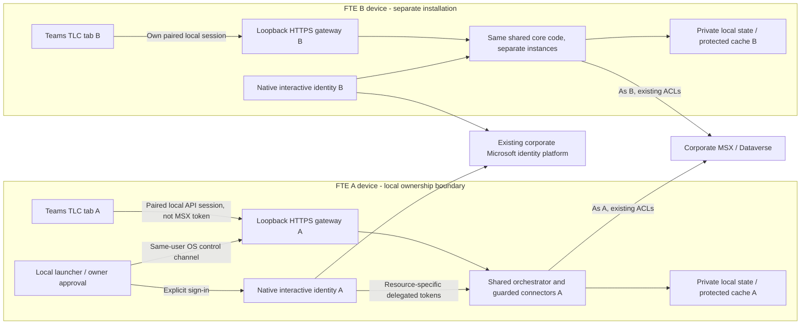
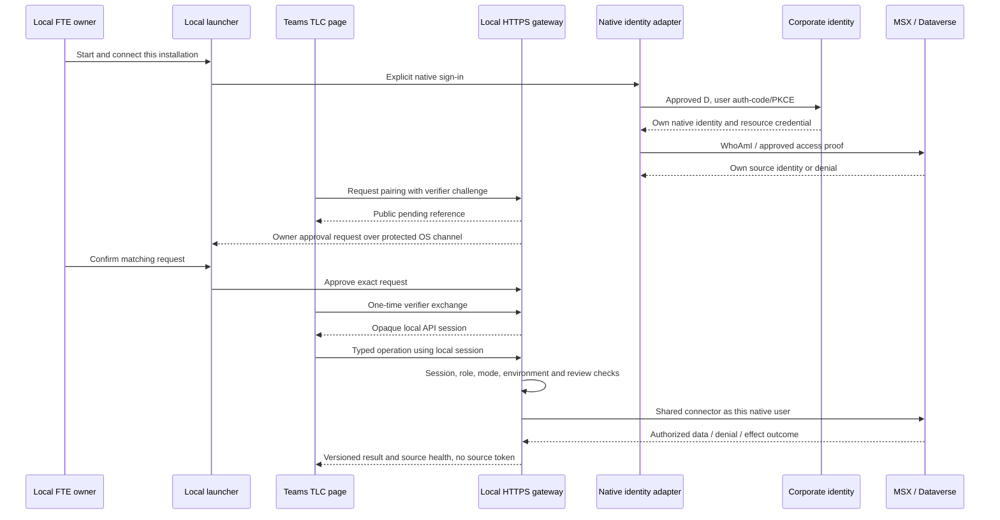

# Teams TLC: Per-User Live MSX Connectivity

## Feasibility, architecture, design, and implementation plan

**Status:** Native-local software and the additive current-user Azure CLI profile are implemented with offline regression validation. The CLI route supports automatic deal-team Portfolio and explicitly reviewed Desktop-equivalent MSX writes without a new native app registration. This is not a claim of real source acceptance: only the end user connects to and operates on actual MSX. Starting a live backend is not proof of a source connection.

**Implementation authorization:** The user subsequently authorized autonomous incremental implementation. No tenant provisioning, registration/consent change, Git integration or real MSX access is authorized. The user explicitly requires **all engineering testing to remain offline**: do not sign in, read, create, update or delete actual MSX records. End users perform actual source reads/writes themselves after launching and connecting.

**Repository document:** `docs/TEAMs/Teams-Live-MSX-Connectivity.md`, excluded from Git using `/docs/TEAMs/Teams-Live-MSX-Connectivity.md`.

**Evidence baseline:** Primary checkout on `feature/vscode-extension-Teams`, commit `2152e73`, including the current uncommitted Teams UI revamp. The prior [UI revamp plan][ui-plan] remains a separate existing document; this design does not overwrite it.

### Authoritative user requirements

1. Each user deploys the TLC runtime on **their own machine** and connects from there.
2. There is **no centrally shared TLC backend, token broker, or application-state store**.
3. Corporate MSX/Dataverse is the shared business system. Its existing Microsoft identity infrastructure is necessarily still used for OAuth.
4. Prefer reuse of VS Code's working sign-in approach/approval, or the Desktop app's approach, over inventing a new centrally operated service.
5. Compare the Desktop-style and legitimate VS Code-hosted alternatives.
6. Present the **full capability and limitation matrix first**. Do not assume that a reduced feature scope has been approved.
7. Produce one local Markdown document combining architecture, design, and implementation, in the existing Teams documentation folder and excluded from Git.
8. Implement/test with sanitized fixtures and mocked native/source transports only. Real MSX data operations are reserved for the end user, not engineering validation.

### Additive current-user CLI profile (2026-10-19)

The user subsequently requested live mode using the logged-in user's identity
and automatic default accounts from deal-team membership. The implemented
`local-azure-cli` route reuses the installed CLI's existing user session and
**does not replace or silently reduce the native profile below**:

- No new native/API/SPA/bot registration, copied VS Code token or shared TLC
  resource. Public local configuration pins tenant and the existing MSX resource.
- Signed delegated source JWT issuer/audience/scope/subject checks plus own
  `WhoAmI` -> enabled `systemuser.azureactivedirectoryobjectid` mapping.
- Explicit protected owner Connect and page approval, exact loopback HTTPS,
  private encrypted local state, current-account revocation and bounded sessions.
- No invented `TLC.Teams.User`/Writer/FTE authority. A separate internal
  owner-verified source capability allows private reads and, when explicitly
  configured with `TLC_TEAMS_CLI_WRITE_MODE=reviewed`, the same shared MSX writes
  as Desktop. Exact approval, source permissions, native concurrency and durable
  receipts remain mandatory. Read-only remains the standalone runtime default;
  admin and publication permissions remain denied. Optional MCP/Graph/Foundry are explicitly
  unavailable in this profile rather than silently substituted.
- Existing shared `LiveMsxConnector` and orchestrator resolve the current
  Dataverse user, active deal teams/opportunities and distinct default accounts.
  No user/account ID is supplied by the browser.
- The single launcher offers a Sample/Live menu and discovers the standard
  private configuration and trusted PEM paths. Live defaults to reviewed CLI
  writes; an explicit read-only setting is honored. It does not sign in or read
  MSX during startup. Switching modes replaces only its verified owned runtime.
- CLI public configuration is independently versioned **1.2**, with `writeMode`. Native public
  configuration and owner/pairing protocol remain **1.0**.

See the maintained [CLI launch/connection instructions](../runbooks/teams-app.md#per-user-windows-msx-using-the-existing-cli-user).
Engineering tests use generated tokens, sanitized rows and mocked transports only.

## 1. Capability and limitation matrix: decisions before implementation

This matrix distinguishes access to the common corporate system from sharing TLC-specific state. A user installing the same app on another laptop does **not** make their local SQLite store or `localhost` endpoint shared.

| Capability | Feasibility with one local installation per user | Required work / remaining limitation |
| --- | --- | --- |
| Personal Teams Portfolio, account/opportunity/milestone reads | **Feasible, conditional on each user's existing MSX rights and an approved native client** | Local native sign-in, secure browser-to-local-runtime session, source identity mapping, and live-loopback packaging support. |
| Local discovery and private account curation | **Feasible** through existing core operations | Preferences stay on that user's device; no cross-device synchronization is implied. |
| MCEM evaluation and grounded deterministic live guidance like the extension | **Feasible** using existing live-data logic | Extract/reuse the extension's deterministic live agent registry and guidance connector through a shared package; do not import extension internals or substitute sample facts. |
| Foundry-backed agent responses | **Conditional, separate from MSX connectivity** | Each local installation needs an approved workload credential/project configuration. Foundry is an external service, not something made local by running Node locally. It must not be a prerequisite for a simple MSX connection test. No new shared TLC Foundry deployment is assumed. |
| Dataverse MCP Plays | **Conditional independently of REST** | The actual native client must have the correct MCP permission, be enabled in the corporate environment's allowed-client list, and pass a real guarded read. REST success alone is insufficient. |
| Existing reviewed opportunity/milestone/task/team writes | **Technically feasible; not authorized by this investigation** | Retain native source privileges, Teams writer admission, exact private review, concurrency evidence, and durable outcome receipts. Prove read access first; use approved test records for later write acceptance. |
| Word export / unsent email draft | **Feasible locally** | Continue using existing authorized document builders. No automatic mail sending or Mail.Send grant is introduced. |
| Seller Dashboard using a private Windows earnings profile | **Separate design decision** | Current Teams intentionally denies host-profile access. A per-user topology may support a later owner-bound native profile path, but MSX connectivity is not permission to enable it. Do not remove the existing denial or use sample fallback silently. |
| Each user's local run history and Activity | **Feasible** | Durable local state and restart/unknown-outcome handling remain required. Another machine will not see that history. |
| Channel/group-chat tab showing each viewer's own authorized MSX data | **Possible with redesign; not unchanged** | Every viewer must have the local runtime available at the manifest origin. A shared navigation reference needs a portable, approved binding mechanism; the current publisher's local binding ID is not resolvable in other local stores. |
| Cross-user TLC context bindings / shared artifact lookup | **Not supported by the current local-store design** | Consider existing Teams configuration metadata or an explicitly approved MSX/Dataverse metadata location. This requires a separate authorization/disclosure/schema decision. Do not silently introduce a new central TLC store or place private payloads in URLs. |
| Meeting transcript acquisition | **Conditional and not an MSX-only permission** | A local user can potentially use delegated Graph read APIs with approved grants and actual meeting access. Local foreground/polling acquisition does not require a webhook receiver; the existing subscription/callback path does. |
| Private meeting preparation / review panel | **Feasible where that Teams client supports the canvas** | Use the viewer's local connection and existing review controls. Preserve explicit denied/not-ready/unsupported states. |
| Shared meeting stage | **Conditional redesign, not automatically solved** | Presenter pixels and per-viewer stage loading have disclosure consequences. An approved artifact must reach intended viewers without treating one user's local artifact ID or token as shared authority. Existing live audience-admission block remains. |
| Current cloud bot / query message extension callbacks | **Not reachable at another user's private `localhost` endpoint** | They need an approved public endpoint/relay or per-install exposure and identities. None is assumed. A personal-tab launch link is not equivalent to a working bot. |
| Notifications | **Local/in-app completion and Activity are feasible; proactive Teams delivery is conditional** | Do not relabel a local toast/poll as a proactive bot or activity-feed notification. Current cloud delivery needs its corresponding reachable service and permissions. |
| Teams mobile accessing the laptop's `localhost` | **Not feasible by that URL** | `localhost` on the phone is the phone. A different approved connectivity design would be necessary. |
| Remote/VDI or multiple Windows users on one host | **Not established** | The runtime and Teams client must share the relevant device/session boundary. TCP ports are not scoped to Windows user accounts. Do not assume the own-machine design covers shared-session hosts. |
| Corporate licensing, Conditional Access, FTE entitlement, and MSX row privileges | **Remain mandatory external gates** | An installation, corporate email address, OAuth token, or reused app ID does not create these rights. |

**No feature-removal decision has been made.** Before implementing live connectivity, the product owner must classify the conditional rows as required for the first live release, separately redesigned, or intentionally unavailable with truthful UI. Under a strict no-new-shared-resource constraint, the original three-document full collaborative suite cannot simply be declared complete by changing authentication.

## 2. Executive conclusion: what can actually be reused?

**Yes: per-user Live MSX connectivity is technically feasible with the Desktop-style approach.** Each user's local native process can authenticate that user, acquire delegated source tokens, and call the existing MSX connector and orchestrator. Teams remains the browser presentation, not the source credential owner.

This is a better fit for the clarified requirement than making a central API perform OBO for all users. **The local installation is still a companion runtime**, but it is the runtime every user already intends to deploy, not a new centrally operated service.

### Reuse and approval are different questions

| Reuse candidate | What can be reused | What cannot be assumed |
| --- | --- | --- |
| Approved TLC-owned Desktop registration, alias **D** | Same native client identity, tenant, approved loopback callback, delegated permissions, and source client allowlisting, where the owner permits this use | That the example configuration is approved; that a new resource/scope is already consented; or that a Desktop approval automatically authorizes a different client ID. |
| Desktop interactive sign-in pattern | `InteractiveBrowserCredential` / native MSAL authorization-code with PKCE, per-user token ownership, and common source connectors | That copying the Electron process credential into an unauthenticated HTTP server preserves Electron's trusted-sender boundary. |
| Existing VS Code Microsoft authentication provider | A genuine installed VS Code extension can call `vscode.authentication.getSession` under the real host's supported process | That a standalone Node process or Teams iframe can call that API, or can borrow VS Code's first-party app ID to inherit its approval. |
| Existing admin-consent procedure | Owner review, application/resource/scope verification, and corporate allowlisting workflow | Consent is not portable merely because two apps have similar names or run on the same computer. |

**Preferred decision path**

1. Verify an existing **TLC-owned** native registration D and its permitted use. Reuse it for the local native sign-in if it already covers the intended MSX resource.
2. Keep its native redirect and resource/scopes unchanged where possible. Because source tokens still originate from D, an existing valid source grant/allowlist entry may be reusable; verify rather than re-request blindly.
3. Add MCP or other resource grants only if genuinely absent and approved. No new Teams API/SPA/bot registration is intrinsically required for the private local MSX path proposed here.
4. If D is unavailable but each user already has the working VS Code extension, evaluate the **real VS Code-hosted local provider** alternative. Keep source credentials inside that host; do not export them to Teams or a separate generic process.
5. If neither approved native path is permitted, report that gate. Do not use a shared operator login, copied tokens, application-only MSX access, or a copied Microsoft first-party client ID as a workaround.

**This does not prove zero additional approval.** Client ownership/use policy, FTE eligibility, custom-app/localhost policy, new scopes, and device compliance may still need corporate owner action even if no new app registration is created.

## 3. Evidence and confidence

Knowledge labels: **U** user-confirmed requirement; **C** inspected source/installed-version fact; **T** executed offline check; **D** documented platform capability; **P** proposed design; **G** unclosed external gate.

| ID | Evidence | Consequence / status |
| --- | --- | --- |
| E01 | [VS Code authentication][extension-auth] requests `<resource>/.default` through `vscode.authentication.getSession('microsoft', ...)`; [extension composition][extension-live] injects that token provider into live MSX/Play services | Host-specific sign-in is reusable only within the actual extension host. **C** |
| E02 | [Desktop runtime credentials][desktop-credentials] selects `InteractiveBrowserCredential` with its configured `clientId`, `tenantId`, and `redirectUri`; CLI is a separate branch | The existing owned native interactive route is a concrete reuse pattern. The active corporate registration/grants were not inspected. **C/G** |
| E03 | [Desktop token provider][desktop-token-provider] caches native source tokens and decodes an expected email domain for display/admission | Do not promote its domain check into proof of FTE eligibility or authentication of an HTTP browser caller. **C** |
| E04 | [Electron main][desktop-main] uses `assertTrustedSender` before IPC operations | Teams HTTP needs its own equivalent caller-admission boundary; loopback alone is not that boundary. **C/P** |
| E05 | [Current Teams browser auth][teams-browser-auth], [API auth][teams-auth], and [configuration][teams-configuration] implement frontend API tokens and server resource-specific OBO | `RUNTIME_PROFILE=local` currently means local storage/workload choices, **not** Desktop-style source sign-in. **C** |
| E06 | [Teams server][teams-server] requires live Foundry/state/disclosure/bot setup and builds per-principal services; [shared live services][application-runtime] uses source tokens supplied by its caller | Existing core can be reused, but native auth must be explicitly integrated rather than toggled on. **C/P** |
| E07 | [Live MSX connector][msx-live] uses source `WhoAmI`, user-specific portfolio access, trusted resource URLs, and native concurrency evidence | Keep these mechanisms. Dataverse `UserId` and Entra `oid` are different identifiers. **C** |
| E08 | [Launcher][teams-runner] rejects localhost live runs; [packager][teams-packager] rejects a development package claiming the live suite and requires bot identity for the current live profile | A new explicit per-user local-live capability/profile path is required. Removing guards globally is not a solution. **C/P** |
| E09 | Installed packages: TeamsJS **2.58.0**, MSAL Browser **5.25.1**, MSAL Node **5.6.0**, Azure Identity **4.13.2** | Base implementation tests on these versions, not unqualified latest examples. **C** |
| E10 | Existing auth characterization command below passed **35 tests in 4 files** | Signed synthetic JWT validation, mocked credentials/resources and sample browser initialization are covered; corporate login, live grants and native pairing are not proven. **T** |
| E11 | Existing `https://localhost:3978/api/health` returned `ready`, `surface=teams`, `mode=sample` | The installed local runtime is still sample. This was a health-only request, not a live MSX probe. **T** |
| E12 | Microsoft documents native interactive authorization-code/PKCE, native registration, per-application consent, and Dataverse custom-client/MCP allowlisting [S01-S05] | Platform feasibility is documented; the corporate environment still owns actual approval. **D/G** |

Executed without requesting real tokens:

```powershell
npm test -- tests\unit\teams\authentication.test.ts tests\unit\vscode-extension\authentication.test.ts tests\electron\runtime-credentials.test.ts tests\unit\teams\browser-host.test.ts
```

### Important version correction

MSAL dev documentation describes NAA active-account APIs as effectively host-owned/no-ops, but the **installed 5.25.1 controller implements cache-backed active-account methods**. Therefore this investigation does **not** claim those methods are absent or that interactive NAA can never work.

The actual source concern is narrower: current browser code does not attempt silent acquisition when no active account is available. The current fallback also has no MSAL redirect bridge/popup relay. These require pinned-version live-flow tests if retaining that hosted/NAA route. They are not prerequisites for making the proposed local-native source route depend on NAA.

The installed SDK exports redirect-bridge and popup-relay mechanisms [S06-S07]. Do not copy incompatible dev snippets or weaken browser storage/CSP controls. The existing sample-only browser auth tests do not establish live NAA success.

## A. Architecture

## 4. Preferred topology: native credentials owned by each local installation



There is no central TLC service, Table Storage, managed identity, shared token cache, or operator credential in this topology. Both devices can use `https://localhost:3978`, because each resolves it locally. The Teams client and runtime must be on the corresponding device.

### Responsibilities

| Component | Existing responsibility reused | Proposed addition / constraint |
| --- | --- | --- |
| Local launcher | Build/package/start/owned-process checks and HTTPS verification | Explicit local-live mode, trusted owner sign-in/pair approval, per-install source configuration; no silent CLI fallback. |
| Native identity adapter | Desktop Azure Identity/native MSAL flow using approved registration D | Stable native subject/resource context, explicit owner interaction, resource-specific token acquisition, disconnect and cache lifecycle. |
| Local API/session authenticator | Teams typed HTTP transport and security headers | A distinct opaque local-session strategy, not a forged API-A JWT or acceptance of a Dataverse token as an API token. |
| Application composition | Shared service factory, source connector, workflow host and agent registry | Credential injection and capability-aware/lazy initialization; no per-UI fork of orchestration. |
| Local state | Existing encrypted durable SQLite and user/environment partitions | Native identity/Windows owner binding, protected state key and restart/reconciliation behavior. |
| UI | Existing Teams React workbench, themes, source states and review dialog | Local-connect/pair/reconnect UX, truthful capability matrix, and visible native account/environment. |
| Models/agents | Existing read-only agents and deterministic MCEM logic | No new model, coordinator, RAG service or agent is needed to authenticate or prove connectivity. |

### What “like Desktop” means

Reuse the native OAuth process, approved client identity, source connector and shared core. Do **not** copy global credentials, wildcard write concurrency, or email-only admission into a new web boundary. Keep Teams' existing stricter reviewed-effect controls and `requireConditionalWrites` behavior.

## 5. Alternative: genuine VS Code-hosted local provider

| Property | Desktop-style local runtime — preferred | Actual VS Code-hosted provider — conditional |
| --- | --- | --- |
| Who acquires source tokens? | That user's local native adapter using approved D | That user's installed VS Code Microsoft provider |
| Additional runtime prerequisite | Node/package or an approved native launcher | VS Code plus the extension must remain available |
| Corporate source approval reuse | Existing D grants may apply if the same identity/scopes/use are approved | Only the actual supported VS Code-hosted flow can use its existing approval; no client-ID copying |
| Tokens in Teams / transferred to generic Node? | No | No; execute source operations inside the real host |
| Shared TLC infrastructure | None | None |
| New work | Local caller admission, identity lifecycle, configuration and packaging | The same admission work plus a supported host gateway/operation adapter and lifecycle/asset packaging |
| Main failure | Native client/resource grant or device policy unavailable | Host closes, session changes, scope approval fails, or cross-surface gateway use is not approved |
| Decision | First choice if D is available and permitted | Fallback to evaluate if approved native D is unavailable and users accept the VS Code dependency |

The VS Code alternative must keep one core owner for a request. Do not create a second orchestrator in a proxy process or import another app's private host modules. Extract a browser-safe/shared host seam where justified and package the Teams client correctly; the VS Code webview command bridge is not the Teams transport.

A new headless process calling `getSession`, copying VS Code's public client ID, returning its access token through HTTP, or scraping another app's token cache is **not** this alternative.

## 6. Registration and permission reuse: explicit go/no-go record

“D” is an alias for an **owner-verified existing TLC native registration**, not one of the placeholder GUIDs in the example configuration.

| Check | Evidence needed | Result if missing |
| --- | --- | --- |
| Registration ownership/use | Corporate owner confirms the exact existing client may support this per-user TLC runtime | Do not claim its approval is reusable. |
| Tenant and user | Correct corporate authority and a permitted signed-in user; supported native redirect | Stop sign-in with a specific configuration/tenant reason. |
| MSX delegated grant | Applicable Dynamics CRM organization-user permission and exact resource/scope; actual `WhoAmI` | No live readiness; no app-only substitution. |
| Actual user access | Licensed/enabled Dataverse user and real row/field/team privileges | Display denial/empty authorized scope accurately; do not borrow another identity. |
| MCP grant and client enablement | Exact environment MCP permission/scope and the actual client D enabled in the allowed-client list | REST may be connected while MCP remains blocked. |
| FTE/role authority | IAM/data-owner-approved eligibility and operation-role policy for the native subject | Corporate email or source access alone is not FTE proof. Release admission stays gated. |
| Device and Conditional Access | MFA, device compliance, broker requirements and corporate proxy/TLS behavior on a representative second machine | Treat as an access/policy block; no password/token export workaround. |
| Teams application policy | Localhost/custom-app package and per-user runtime deployment allowed | Internal distribution remains blocked even if the native source login works. |

For a private local native path, **A API / B SPA / C bot registrations are not inherently required for MSX authentication**. They belong to the current hosted-style/full-suite implementation. New registrations are needed only if no suitable approved identity exists or an explicitly selected feature requires them.

Normal Entra authentication remains part of accessing the corporate system. “No central TLC resources” cannot mean bypassing MSX's identity provider, user rights, or consent policies.

## B. Detailed design

## 7. Credential and caller-admission design

### 7.1 Native source identity

1. The owner launches the local installation under their Windows user.
2. The launcher explicitly initiates native authorization-code/PKCE using approved D and its allowed callback. Use the existing Desktop credential pattern.
3. Obtain stable native identity metadata from the trusted SDK authentication result/record. If the Azure Identity abstraction is insufficient for subject/eligibility evidence, use the supported native MSAL result inside the adapter, not ad-hoc browser claims.
4. Validate configured tenant/resource and authoritative eligibility. Derive roles through the approved native-subject policy; never accept `isFte`, `roles`, email or a resource URL from the browser as authority.
5. Acquire the MSX token for the configured resource. Resolve Dataverse identity with `WhoAmI`; verify the approved Entra-to-Dataverse user mapping where required. Do not assume both IDs are equal.
6. Build that user's connector/core instance and namespace local preferences/results by tenant, environment and native subject.

The default source-token cache is process memory. Persistence, if needed, must use an approved OS-protected cache; do not serialize refresh/access tokens into ordinary JSON or the checkout. Keep MSX, MCP, Graph and Foundry resource scopes separate.

Configure native HTTP-read acquisition to avoid automatic interactive prompts. A failed silent/native cache acquisition returns `reconnect-required`; only an explicit trusted owner action may initiate sign-in. The Azure Identity option for disabling automatic authentication supports this pattern [S01].

### 7.2 Why the local browser still needs authentication

Electron has a trusted renderer and IPC sender check. A loopback HTTP listener can receive requests from browsers, other local processes and malicious websites. A localhost URL, CORS rule, Teams context or a decoded email suffix is not proof that a particular page may use the native connection.

**Proposed local pairing protocol — new implementation, not an existing feature:**

1. A newly loaded trusted TLC page starts unpaired and receives no business data.
2. The page generates a random, memory-only verifier and sends its S256 challenge to a bounded local pairing-request endpoint. The request has no source privilege.
3. The backend creates a short-lived pending request bound to the challenge, exact approved origin, runtime instance/generation, Windows owner and native subject/environment. Return a public reference/user code, not a source token.
4. The local launcher presents the same reference and requests explicit owner approval through an OS-user-protected control channel. On Windows, a named pipe with the owner/SYSTEM ACL is the proposed mechanism. An HTTP browser cannot approve itself.
5. After matching and approving the request locally, the page exchanges its verifier once over trusted loopback HTTPS.
6. The backend returns a short-lived random opaque **local API session capability**. Store only its hash/server binding; keep the client capability in application memory. It is not an MSX, Graph, Foundry or API-A token.
7. Each private operation validates that local session, generation, native identity, capability/role and normal source authorization. Logout, account switch, runtime restart and expiry invalidate the session.

The verifier/session must never be in URLs, telemetry, cards, browser storage or distribution files. An unauthenticated HTTP request must not trigger native sign-in, approve a pairing, grant writer authority or disclose account names.

This is a PKCE-style local-pairing **proposal**, not OAuth DPoP or a claim that a new central authorization server exists. Its threat model and implementation need dedicated negative tests. Same-OS-user malware remains a device-security concern; browser-origin controls do not sandbox a compromised owner account.

Teams context may help explain an apparent account mismatch, but it is not cryptographic caller/FTE authority. The UI must clearly identify the native MSX connection being used, and accidental Teams/native account mismatches must be blocked or explicitly resolved under the approved policy.

### 7.3 End-to-end local sequence



## 8. Configuration and startup: not just changing `sample` to `live`

Keep three concepts separate:

| Concern | Existing / proposed setting | Meaning |
| --- | --- | --- |
| Source data mode | Existing `TLC_TEAMS_MODE=live` | Real authorized sources; never silently fall back to sample. |
| Storage/host placement | Existing `TLC_TEAMS_RUNTIME_PROFILE=local` | Local durable state rather than Azure-hosted Table storage. |
| Incoming/source authentication | Proposed explicit `local-interactive` or `vscode-hosted-local` strategy | Selects local caller admission and native source identity, not hosted API-token/OBO assumptions. |
| Capability set | Proposed validated per-install availability/configuration | Records the approved feature decisions from section 1; does not silently remove features. |
| Frontend/backend origin | Existing origin/port/host and PEM paths | Default approved local pair remains `https://localhost:3978`; both package URLs and listener must agree. |
| Native registration | New local configuration referencing approved D, tenant and native redirect | Public registration coordinates, not a client secret and not copied VS Code identity. |
| Native eligibility policy | New approved owner/role resolution input | Authoritative subject/role admission; not a user-editable `isFte=true` flag. |
| State encryption | Existing 32-byte key/protected SQLite behavior | Retain encryption and local owner ACLs; no new central key/store. |

The native OAuth callback and the Teams HTTPS port are different concepts. Do not force an SDK-selected native callback onto the application listener. Register and verify each required native redirect exactly.

### Current code gaps requiring explicit change

| Gap | Current behavior | Required design change |
| --- | --- | --- |
| Authentication strategy | Teams expects a signed API-A token and creates OBO source tokens | Separate local-session authenticator and native resource-token provider; keep hosted auth fail-closed and unchanged unless explicitly selected. |
| Live configuration coupling | API/SPA/bot credentials and MCP settings are required together | Native-local validation must require its actual dependencies, not dummy A/B/C secrets. |
| Startup coupling | Foundry and disclosure/bot setup are eagerly required for live startup | Separate source connection/diagnostics from optional feature initialization; maintain explicit unavailable states. |
| Native identity API | Current browser expects live NAA/MSAL and `getToken()` | Add a versioned local-connect/pair strategy while preserving memory-only API credentials. |
| Loopback packaging | Current launcher and manifest builder reject localhost live-suite claims | Add an explicit local-live packaging/profile path with accurate supported capability declarations; retain existing shared/live guards. |
| Browser trust | Existing HTTP has same-origin checks but no native owner pairing | Add the local trusted-caller equivalent before source reads or reviewed actions. |
| Guidance without Foundry | Extension has deterministic live guidance; Teams live factory always builds Foundry agents | Reuse/extract the existing live registry under an explicit configuration. No new agent or silent fake-live fallback. |
| Collaboration state/callbacks | Existing bindings/artifacts are local IDs; bot/subscription paths assume reachable callbacks | Resolve section 1 decisions before declaring those features supported. |

The new public configuration/session shape belongs in strict common Zod contracts. If existing wire shapes change, bump the relevant collaboration/public-config contract and update producers, clients and tests. Do not bump unrelated business/workflow contracts or fork the core.

## 9. Capabilities, outputs, failures and human controls

| Capability | Method and output | Failure / human action |
| --- | --- | --- |
| Connect native owner | Explicit SDK sign-in, tenant/resource/eligibility check, own source mapping | Configuration, consent, device-policy and eligibility errors are distinct. Owner corrects the relevant condition; no token pasting. |
| Pair the page | Challenge-bound pending request, protected owner approval, one-use exchange | Mismatch/expiry/denial gives no local capability and no data. Start a fresh pairing explicitly. |
| Prove MSX | Ordinary deterministic `WhoAmI`/mapping and approved minimal read through existing connector seams | Return source denial or mapping failure, not a successful blank portfolio. No model call is needed. |
| Prove MCP | Approved client/scope, initialize, tool listing and one allowlisted bounded read | Show MCP-specific consent/client/tool policy failure separately from REST readiness. |
| Use live Portfolio | Existing native-user portfolio filters and versioned source results | Stale/revoked scope clears inappropriate caches and results; source failures are visible. |
| Request a write | Existing preview, role/source checks, exact confirmation and durable receipt | Conflict requires a new preview. Timeout after dispatch remains effect unknown; do not resubmit merely because readback is empty. |
| Disconnect/restart | Revoke local capabilities and native cache access, stop new work, preserve authorized local receipts | Reconnect requires native identity/pairing as appropriate; do not replay unknown effects. |

Proposed UI states: **Sample**, **Local live configuration incomplete**, **Native sign-in required**, **Pairing pending**, **Identity verified**, **MSX connected**, **MCP blocked/connected**, **Feature unavailable pending decision**, **Reconnect required**, and **Action outcome unknown**.

“Signed into Teams,” “native token acquired,” “MSX REST connected,” and “all TLC capabilities available” are different claims. `GET /api/health` is liveness, not MSX authorization.

### Populated cases

**Ordinary case:** FTE A starts their own runtime, signs in through approved D, and resolves their Dataverse user. They approve the matching Teams page pairing locally. Portfolio returns only A's existing source working set. FTE B repeats on a different machine; no preference, source token, result cache, or receipt is taken from A's installation.

**Mismatch case:** A page on A's machine presents an unsigned Teams context naming B, or tries another pending reference/verifier. The gateway does not turn that string into B or grant access. It denies the mismatch/invalid exchange and directs the owner to resolve the actual account connection.

**Partial-connectivity case:** D can call REST, but MCP returns a client/scope denial. Portfolio can be reported MSX-connected; Plays remains explicitly blocked. No retry switches to VS Code's client ID or another user's CLI login.

**Write interruption case:** The user confirms a reviewed milestone change, then the laptop sleeps after dispatch. On restart, the local receipt remains effect-unknown until authoritative reconciliation. A fresh token, matching current value, or an empty read does not by itself authorize repeating the write.

## 10. Local security, state and operational limits

### Non-negotiable controls

- Bind only to loopback; verify exact Host and Origin, permitted fetch metadata, trusted HTTPS and CSP. No wildcard CORS, LAN bind, automatic tunnel or disabled certificate validation.
- Keep each user's certificate/private key local. Do not distribute one private localhost key to all users. Corporate-approved certificate deployment and Teams/WebView trust behavior require validation.
- Keep source tokens in the native owner process/OS-protected cache, never the renderer. Retain strict query/tool allowlists and source ACLs.
- Derive identity from the trusted native flow and source mapping. Teams context, local browser fields and email suffixes do not confer FTE or writer roles.
- Serialize identity switches with generation invalidation. Stop stale work and clear old private UI/cache state before admitting another native identity.
- Preserve local encrypted state, partitioning, current-source/concurrency checks and approval receipts. Local does not mean safe to drop write controls.
- Protect the owner control channel with Windows user ACLs. A public HTTP pairing endpoint may request but may not approve itself.
- Preserve admission read-only mode for diagnostics. Removing `Writer` authority and source effects is distinct from permitting ordinary source reads.
- Do not enable a private Seller Dashboard profile or wider Graph/disclosure privileges as an incidental consequence of local-native auth.

### Limits register

Numbers below are **runtime controls or proposals, not implementation duration estimates**.

| Area | Existing fact / proposal | Stop outcome |
| --- | --- | --- |
| Agent/model loop for connection proof | Not needed; zero LLM calls/tokens for auth/WhoAmI diagnostics | A structured connection result or explicit blocking gate. |
| Interactive sign-in | One explicit owner attempt; no automatic HTTP-triggered prompt/retry loop. Owner-configured expiry/cancellation is required. **P** | Sign-in required/denied; no source access. |
| Pairing | Short expiry, one-use verifier, bounded pending requests/attempts; proposed initial expiry 5 minutes and at most 3 pending requests per installation, subject to security validation. **P** | Expired/denied, no business result; fresh owner approval required. |
| Local API session | Expiry no later than the approved native identity/eligibility context; revoke on restart/disconnect/account-generation change. **P** | 401/reconnect/pair again; never sample fallback. |
| Diagnostic HTTP/token calls | Explicit total deadline/cancellation and bounded idempotent read attempts are required. Existing MSX `requestJson` has no declared per-fetch deadline. **C/P** | Timeout with source state, not success. Propagate cancellation rather than merely abandoning a promise. |
| Enabled Dataverse MCP registry | Current limits include 15-second connect, 60-second call, concurrency 2, 8 tool calls/request, 2,000 rows/call, 1 MB result and 2 configured attempts. **C** | Existing quota/timeout/truncation/error semantics; no uncontrolled bypass. |
| Existing Teams live request admission | Current code uses 60 general requests/user/minute and bounded agent-work admission; retain or deliberately recalibrate for the local profile. **C/P** | Explicit quota state, not a credential switch. |
| Sessions and memory | Existing hosted-style session map caps at 50; this is not a capacity target for a one-owner local gateway. **C** | Enforce one active native subject/generation and bounded page sessions; safely dispose idle work. |
| Retried external writes | No auth-driven blind replay; preserve durable claim/receipt and current approval rules. **C/P** | Conflict/effect-unknown and authorized reconciliation. |
| Persistence and recovery | Default source token cache is in-process; optional protected cache requires approval. Local receipt/state recovery must be tested. **P** | Reauthentication is acceptable; loss of uncertainty/receipt history is not. |
| Fees/capacity | No new TLC hosting bill is assumed. Existing licensing, MSX/MCP/AI service terms, endpoint protection and support still apply. **G** | Owner resolves entitlement/cost; do not promise free or unlimited service. |

An own-machine target excludes automatic assumptions about mobile, remote Teams sessions, shared Windows hosts and unattended source acquisition while the machine sleeps.

## C. Implementation and verification plan

## 11. Dependency-ordered increments

This is a future implementation plan. **Only documentation publication is presently requested.** Feature scope from the matrix must be decided before a release is called complete.

| ID | Increment | Dependencies | Test-first acceptance and stop gate |
| --- | --- | --- | --- |
| L00 | Confirm capability matrix, owners and approved registration reuse | None | Record D ownership, tenant, exact scopes, native redirect, client allowlist and applicable eligibility/use policy. Explicit decisions for every conditional collaboration row. No invented approval. |
| L01 | Prove existing native MSX authentication on approved devices/users | L00 | Use approved D for two authorized FTEs on their own devices; prove correct source identity, an allowed read and a denied/unavailable scope. Redact evidence; no real write. A mock pass is not this gate. |
| L02 | Add native resource-provider and configuration seams | L00 | Unit tests first for resource/tenant mismatch, absent grant, expired credentials, no CLI/identity fallback, and no automatic prompt from HTTP. Inject into shared composition; do not import app internals. |
| L03 | Build protected local owner approval and session admission | L02 | Red tests for self-approval, wrong verifier/reference, expired/replayed exchange, hostile Origin/Host, cross-owner pipe access, account-generation change and unauthenticated source calls. Then implement and test the exact pairing/session protocol. |
| L04 | Add explicit local-live bootstrap / versioned UI connection state | L02, L03 | Native-local startup must not require dummy API/SPA/bot secrets, Table, disclosure or Foundry. Hosted JWT auth remains unchanged. Strict contract/version rejection and unknown strategy fail closed. |
| L05 | Wire source-only diagnostics, Portfolio and live MCEM foundation | L01, L04 | No source token in UI; own WhoAmI mapping; no fake empty/read success; per-user private state and stale-result cancellation. Extract existing deterministic live guidance if selected; maintain extension/Desktop regressions. |
| L06 | Prove MCP Plays through the same approved native identity | L01, L02, L05 | Verify exact scope/client allowlist, handshake/list/guarded read, deny unknown tools and source writes, preserve queue/run/history ownership. A REST-only result is not MCP acceptance. |
| L07 | Admit existing reviewed writes separately | L05, L06 where required | Writer policy + native source privileges + exact actor/target/digest/expiry + native concurrency + receipts. Cancelled review writes nothing; restart/lost-response never blind-replays. Only explicitly authorized test records. |
| L08 | Resolve and implement selected collaboration/optional-source rows | L00, relevant live reads/reviews | No unsupported bot/stage/channel/Graph/profile feature is silently enabled or removed. Test the actual local/polling/reference-distribution design selected by the owner. Missing required rows block full-feature sign-off. |
| L09 | Add truthful local-live manifest, launcher and per-user distribution | L04, L05 and selected capabilities | Test current guards before adding a narrowly gated local-live profile. Match tab/website/API origin; detect port ownership; use each device's own trusted certificate and private state. Do not advertise unreachable cloud callbacks. |
| L10 | Full regression and two-device native Teams acceptance | L06, L07 if required, L08 decisions, L09 | All affected layer tests, actual Teams/WebView login/pairing, account switch, source allow/deny, restart, sleep, no operator borrowing, exact supported-capability matrix, and rollback evidence. |
| LV | Implement the VS Code-hosted fallback only if selected | L00; compare with L02-L05 | Actual VS Code API stays in the host, no token export/copying, explicit owner session capture, silent HTTP reads, host-close/account-switch denial, and shared core/transport parity. Do not implement both providers before the reuse decision. |

TDD means write discriminating failures, implement the smallest coherent increment, run affected tests and preserve existing success paths before proceeding. A registration/consent/deployment-owner gate cannot be closed by adding unit tests.

## 12. File and contract ownership

| Area | Intended change |
| --- | --- |
| `apps/teams/src/configuration.ts` | Explicit auth/capability strategy validation; retain existing data/storage modes and hosted checks. |
| `apps/teams/src/authentication.ts` and focused new local modules | Keep existing JWT/OBO implementation; compose a separate native/local-session strategy instead of weakening it. |
| `apps/teams/src/server.ts` / runtime resources | Compose the selected identity provider, protected owner channel and lazy source services once. Keep HTTP transport free of business logic. |
| `apps/teams/src/client/authentication.ts`, data client and focused connection component | Versioned configuration, paired local API-session lifecycle, native connection status and explicit reauthentication. Never source-token storage. |
| `packages/common/contracts` | Strict local-connection/session/status contracts with appropriate versions; preserve unrelated workflow/business shapes. |
| `packages/orchestrator/application-runtime.ts`, operations/task-agent composition | Reusable source-ready/lazy services and an explicit deterministic live guidance option where selected. No second orchestrator. |
| `packages/connectors` | Native token-provider seam and diagnostics through existing trusted connectors; bounded reads/cancellation where necessary. |
| VS Code/Desktop composition | Only focused extraction/adapters needed for real reuse. Preserve current native sign-in and existing host trust boundaries. |
| `scripts/run-teams-local.ps1`, packager/runtime bundle | Explicit local-live profile, owner sign-in/pairing control, safe own-process lifecycle and accurate manifest/capability selection. |
| Tests/docs | Unit + contract + transport + browser + native/two-device cases; update the three Teams docs/runbook and distribution instructions after actual implementation. |

Candidate modules such as `native-identity`, `local-owner-channel` and `local-session` are responsibilities to implement after review, not already-created files. Reuse existing helpers before creating packages.

## 13. Acceptance matrix

| Family | Discriminating oracle |
| --- | --- |
| Approval reuse | Actual source token flow originates from the owner-approved native D, or the actual VS Code provider in its host. No renamed/copied client identity. |
| Native identity | Two FTEs on separate devices resolve their respective source identities and source scopes. Wrong tenant/eligibility/mapping blocks admission. |
| Local caller | No data before owner approval; wrong/replayed verifier, cross-origin request, remote/LAN request and another Windows user's approval attempt are denied before a source read/effect. |
| Token containment | No downstream credential in browser traffic, URLs/storage, package/archive, telemetry, cards or ordinary state files. Local API capability is scoped, transient and distinct. |
| REST vs MCP | Record separate results. Missing MCP permission/allowlist does not masquerade as source readiness or trigger a different client. |
| Failure UX | Configuration, consent, source denial, native reconnect, pairing expiry, unsupported feature and quota/timeout are distinguishable. No live-to-sample fallback. |
| Lifecycle | Restart invalidates page sessions but retains protected receipt/history; lock/disconnect/account switch prevents stale work. Sleep/dispatch gap remains reconcilable. |
| Writes | Actor-bound review, native ACLs, cancellation, ETag/version conflict, duplicate submit and unknown effect behave as the existing guarded core requires. |
| Teams deployment | Same-device Teams client reaches its own trusted HTTPS listener; tab/website/API ports match. A second device independently deploys and signs in. No tunnel or central state is assumed. |
| Full capability coverage | Every section 1 row has an explicit support decision and corresponding proof or honest block. No full-suite declaration from personal-tab/source-only success. |
| Existing surfaces | Sample mode and existing extension/Desktop/Web behavior remain green after shared extraction. |

Use deterministic fixtures for default tests. Keep real source tests opt-in, read-only first, owner-authorized and free of raw token/customer exports. No live credential/tenant change is performed by this document.

Existing implementation gates to retain:

```powershell
npm run teams:typecheck
npm run teams:build
npm run test:teams
npm run test:smoke:teams
npm run phase0:check
npm run validate:major
```

Run the relevant extension/Desktop/Web builds, parity tests and smoke journeys when a shared component/credential seam changes. The 35 tests executed for this investigation are characterization only; future tests listed here have not been executed as live connectivity acceptance.

## 14. Owners, open gates and handoff

| Gate | Owner / required evidence | Consequence |
| --- | --- | --- |
| Capability scope under no-central-TLC constraint | Product owner reviews section 1, including cross-user state, bots, notifications, Graph and stage | Do not assume an approved reduced release. |
| Existing native D approval and allowed reuse | App/IAM owner provides a secret-free registration/grant/use record | Select Desktop route only after verification; do not demand a new app prematurely. |
| MSX user/license/metadata access | MSX data/environment owner proves actual allowed and denied reads | Corporate source feasibility remains conditional. |
| MCP client/grant | Power Platform/MSX owner validates exact D and environment scope/enablement | MCP-required features remain gated. |
| Native FTE/writer policy | Corporate IAM/data owner identifies authoritative eligibility and operation rights | Do not substitute the Desktop email check or a local flag. |
| Local caller threat model / channel | Security/platform owner accepts and verifies the challenge/approval/session design and OS boundary | No browser source access before this closes. |
| Device, localhost TLS and Teams package policy | Endpoint/Teams owners validate second-device deployment, client support, trust and local-network policy | Local sample success on this machine is insufficient for distribution. |
| Optional remote AI/Graph/profile and shared references | Respective source/disclosure owners | No implicit grants or fake capability readiness. |
| Support, rollout and rollback | Application/endpoint owners define supported clients, install/update/recovery and state/key handling | Operational quality is not proven by the architecture. |

**Readiness:** Platform mechanisms are documented and existing native/connector paths are source-confirmed. The package is sufficient to begin the approval/reuse and local-auth proof increments, with explicit blockers. It is **not** a claim that the current Teams binary connects live or that corporate consent/eligibility has been verified.

**Current acceptance boundary:** implementation is authorized, but real native/source proofs are reserved for the end user. Do not run even the read-only live identity proof during engineering validation. Preserve the working sample installation; use isolated fixtures for software acceptance.

### Local document handling

This approved document is saved in `docs/TEAMs/Teams-Live-MSX-Connectivity.md`; its local reference links are relative to this folder. The exact path `/docs/TEAMs/Teams-Live-MSX-Connectivity.md` remains excluded from Git. The later implementation request authorizes software changes only, not corporate source access, provisioning, committing or pushing.

### Implemented software and deliberate external gates

- New strict `local-connection` v1 protocol; existing sample/hosted public shapes retained.
- Explicit local-interactive configuration with approved native client D, loopback TLS and same frontend/backend port.
- Native MSAL resource provider: own signed ID-token tenant/client/roles and Dataverse systemuser-to-Entra mapping; no email/CLI/VS Code-token authority.
- Protected per-Windows-owner control material plus nonce/HMAC-authenticated local commands; no HTTP owner approval or sign-in.
- Bounded S256 page pairing, hash-only opaque API sessions, per-page/owner revocation, generation-bound reviews and stale-response/download containment.
- Shared real connector/core and extracted deterministic live guidance; no sample data/agents as a live fallback and no mandatory bot/Foundry bootstrap.
- Full capability/limitation panel; native personal package does not advertise unsupported shared/cloud callbacks. The original sample/hosted package and surfaces remain separate.
- Local-native environment template, packaging, launcher and explicit end-user owner commands are covered by offline tests.
- Corporate D approval, IAM role assignment/consent/Conditional Access, actual MCP grant/allowlisting and two-device source acceptance remain **unverified external gates**. Existing Desktop configuration selecting Azure CLI is not proof that its native registration fields are approved or used.

**Offline verification snapshot:** `phase0:check` passed 172 files / 1,032 tests with
15 opt-in skips; the cumulative Teams gate passed 295 tests; all 27 Teams browser
journeys passed, including three controlled native-pairing journeys. The shared
Desktop/Web/VS Code UI suite passed 108 journeys on full rerun, and the separate
major gate/Desktop smoke plus Web/extension builds passed. A Desktop scrollbar
keyboard-timing failure passed three isolated repetitions and the complete rerun;
no unrelated production UI change was made. Final packaged-host checks also cover
the exact public Teams SDK trusted-domain-list CSP resource, strict native TLS
bootstrap, archive contents and frontend/backend origin/port alignment.

See the tracked [Teams runbook](../runbooks/teams-app.md#per-user-windows-native-msx) for exact launch/connect/pair instructions. No real MSX read or write has been performed to prove these software changes.

## Sources

### Inspected project sources

[ui-plan]: ./Teams%20UI%20Revamp.md
[extension-auth]: ../../apps/vscode-extension/src/authentication.ts
[extension-live]: ../../apps/vscode-extension/src/live-provider.ts
[desktop-credentials]: ../../apps/desktop/electron/main/runtime-credentials.ts
[desktop-token-provider]: ../../apps/desktop/electron/main/azure-cli-token-provider.ts
[desktop-main]: ../../apps/desktop/electron/main/index.ts
[teams-browser-auth]: ../../apps/teams/src/client/authentication.ts
[teams-auth]: ../../apps/teams/src/authentication.ts
[teams-configuration]: ../../apps/teams/src/configuration.ts
[teams-server]: ../../apps/teams/src/server.ts
[application-runtime]: ../../packages/orchestrator/application-runtime.ts
[msx-live]: ../../packages/connectors/msx/live.ts
[teams-runner]: ../../scripts/run-teams-local.ps1
[teams-packager]: ../../scripts/package-teams.mjs

Also inspected: the Teams environment example, resource/state composition, principal and reviewed-action guards, MCP limit metadata, native MSAL types, installed browser-controller implementation, and the three existing Teams architecture/design/implementation documents. Those earlier documents describe a broader shared-service/full-suite baseline; the user's per-machine topology is the controlling requirement for this proposal.

### Official platform documentation

- **S01:** [Azure Identity InteractiveBrowserCredential](https://learn.microsoft.com/en-us/javascript/api/@azure/identity/interactivebrowsercredential?view=azure-node-latest) — native browser authorization-code/PKCE and explicit vs automatic interaction.
- **S02:** [Native MSAL PublicClientApplication](https://learn.microsoft.com/en-us/javascript/api/@azure/msal-node/publicclientapplication?view=msal-js-latest) — public-client user-token methods; installed 5.6.0 native interactive API was checked locally.
- **S03:** [Dataverse OAuth](https://learn.microsoft.com/en-us/power-apps/developer/data-platform/authenticate-oauth) — application identity, delegated organization-user permissions and native/web distinctions.
- **S04:** [Dataverse MCP custom clients](https://learn.microsoft.com/en-us/power-apps/maker/data-platform/data-platform-mcp-other-clients) — custom client identity, `mcp.tools`, remote endpoint and environment allowed-client enablement.
- **S05:** [Permissions and consent](https://learn.microsoft.com/en-us/entra/identity-platform/permissions-consent-overview) — application/resource-specific permission and consent authority.
- **S06:** [Teams NAA](https://learn.microsoft.com/en-us/microsoftteams/platform/concepts/authentication/nested-authentication) — relevant to the existing alternate browser auth path, not mandatory for native local source login.
- **S07:** [MSAL redirect bridge](https://github.com/AzureAD/microsoft-authentication-library-for-js/blob/dev/lib/msal-browser/docs/redirect-bridge.md), [iframe guidance](https://github.com/AzureAD/microsoft-authentication-library-for-js/blob/dev/lib/msal-browser/docs/iframe-usage.md), and [configuration](https://github.com/AzureAD/microsoft-authentication-library-for-js/blob/dev/lib/msal-browser/docs/configuration.md) — version-sensitive bridge/relay alternatives; installed 5.25.1 exports were verified.
- **S08:** [Entra OBO](https://learn.microsoft.com/en-us/entra/identity-platform/v2-oauth2-on-behalf-of-flow) — explains the current hosted-style API path and why it is not automatically the chosen local topology.
- **S09:** [Desktop registration/configuration](https://learn.microsoft.com/en-us/entra/identity-platform/scenario-desktop-app-registration) and [SPA configuration](https://learn.microsoft.com/en-us/entra/identity-platform/scenario-spa-app-registration) — native callback and browser platform requirements differ.

Documentation establishes supported mechanisms, not the actual corporate client's approval or execution success. No production-readiness claim is made from source inspection or mocked tests.
