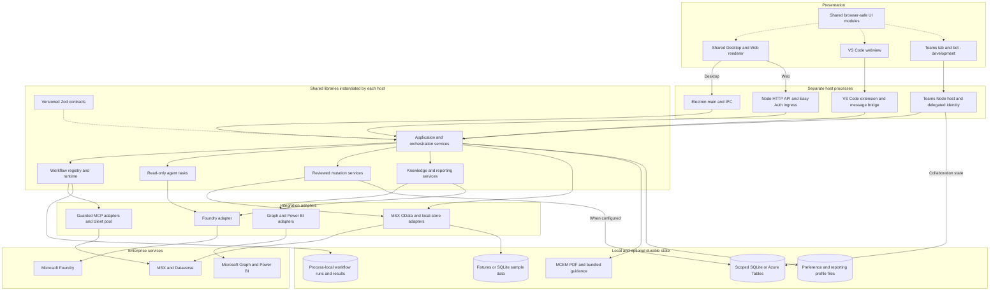
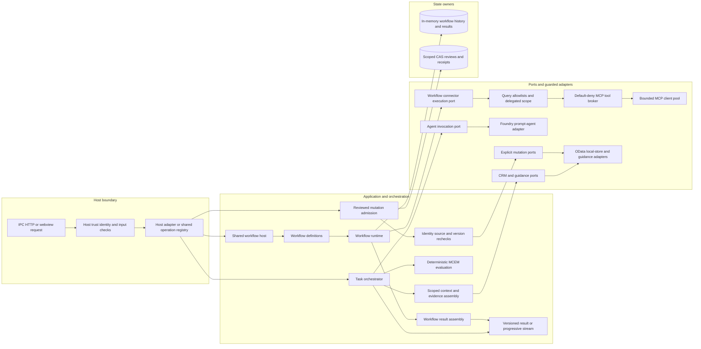

# Architecture Review

## TLC MultiAgent Assist

**Review date:** 2026-10-24  
**Status:** Architectural assessment and recommendations only. The recommendations below are not implemented or approved for implementation by this document.

## Executive summary

**The solution has a sound, reusable architectural foundation. It can accommodate substantial feature growth without a major rewrite. However, it is not yet a fully pluggable platform or a proven horizontally scalable service.**

The strongest assets are the shared application core, versioned contracts, connector interfaces, explicit workflow runtime, and guarded mutation paths. The main weaknesses are incomplete adoption of shared composition, process-local workflow state, some hard-coded extension points, and concentrated UI logic.

**Recommendation: keep the architecture and strengthen its seams rather than replace it.** Finish shared composition and dispatch, correct active-work retention, and make runtime-state assumptions explicit before claiming broader operational scalability.

## 1. Review basis and boundaries

This review documents the source-based assessment of the current working tree, including relevant test implementations. It is not a benchmark, deployed-environment inspection, security certification, or production-readiness sign-off.

| Item | Basis |
| --- | --- |
| Repository | `kprpg/TLC-MultiAgentAssist` |
| Branch observed when documenting | `feature/vscode-extension-Teams` |
| HEAD observed when documenting | `f55f78c79ac9086915a3d993d3550a959a85f003` |
| Working-tree qualification | Modified and untracked files were present. Inspected evidence is not necessarily all contained in the recorded commit. |
| Scope | Robustness, feature extensibility, layering, abstractions, connectors/MCP, host surfaces, orchestration, and current-state diagrams |
| Scale assumption | Consider additional capabilities and multiple concurrent users; no numerical capacity target was supplied |
| Evidence | Static source inspection and reading relevant tests |
| Not performed | Application execution, builds, test execution, load testing, live enterprise calls, or deployed Azure/authentication/failover verification |

The document distinguishes:

- **Source-confirmed behavior:** directly supported by inspected implementation.
- **Architectural interpretation:** implications of that implementation, with conditions stated.
- **Evidence gaps:** operational or quality guarantees not established by this inspection.
- **Proposed changes:** recommendations, not descriptions of already implemented behavior.

The older [engineering assessment](../engineering/Code-Refactoring-Optimization-Tests.md) remains useful historical context, but its component sizes and some implementation-status statements no longer describe the current snapshot. In particular, shared composition/operation modules now exist and Teams has a development runtime, rather than merely an empty stub. This review records that distinction; it does not authorize further Teams scope.

## 2. Answers to the seven architectural questions

| Question | Assessment |
| --- | --- |
| **1. Is the architecture robust, scalable, and expandable?** | **Good foundation for expansion; operational scalability needs strengthening.** Error states, cancellation, policies, and bounded integrations exist, but workflow durability and overload handling have concrete limitations. |
| **2. Is it modularized into neat layers?** | **Mostly.** The principal layers are real, not just folders. Some composition, frontend domain logic, and cross-layer dependencies blur their boundaries. |
| **3. Can capabilities be added without major rearchitecture?** | **Usually yes.** Another agent, connector, dashboard, workflow, or host can follow existing patterns. Adding one still requires coordinated code changes, not simply dropping in a plugin. |
| **4. Are abstractions and interfaces used throughout?** | **Substantial, but not universal.** Good ports exist for agents, connectors, workflow execution, knowledge sources, reporting, and storage. Some are broad or tied to closed capability lists. |
| **5. Are UI, middle, service, data, and agent layers well laid out?** | **Responsibilities are generally sensible.** An HTTP service layer exists. The biggest remaining issues are host-specific assembly and oversized UI roots. |
| **6. Is there a well-thought-out orchestrator?** | **Yes, for the current bounded workflows.** It is not a durable, distributed, general-purpose agent/workflow engine and does not currently execute unrestricted agentic workflows. |
| **7. What is the current solution architecture?** | The following application and component diagrams show the as-built architecture, with development surfaces and storage limitations identified. |

## 3. Application architecture

The most accurate description is:

> A modular TypeScript application core reused by several independently hosted applications, not one central backend service consumed by every UI.

Desktop, Web, VS Code, and the developing Teams surface instantiate shared backend libraries inside their respective hosts. Shared code does not automatically mean shared runtime state.

- Desktop and Web share a renderer.
- VS Code has a separate webview.
- Teams has a substantive development implementation, not merely an empty stub; this does not make it an established production surface.
- Browser-safe UI functionality is shared across surfaces.
- The common workflow runtime, task orchestrator, connector adapters, and contracts are reused by host applications.

<!-- mermaid-checked: no \n, no em-dash/en-dash, no {} in labels, subgraphs are id["label"], arrows are -->|"label"|, all subgraphs closed by end, ids unique -->

**Diagram qualifications:** storage choices vary by host and configuration. Durable mutation receipts and Teams state do not make the general workflow runtime durable. Direct Seismic MCP remains explicitly unavailable; the implemented Seismic knowledge route uses Microsoft Graph. The contracts node is representative: contracts constrain multiple boundaries, not only one application service.

### Technology stack summary

Versions are declarations from [package.json](../../package.json), not runtime measurements.

| Layer | Technology | Declared version | Purpose |
| --- | --- | --- | --- |
| Presentation | React / Fluent UI | 19.2.8 / 9.74.6 | UI components and interaction |
| Desktop host | Electron | 43.5.0 | Native host and IPC |
| Service hosts | Node.js HTTP | Node >=22.12 | Web and Teams endpoints |
| Application core | TypeScript | 6.0.3 | Shared application logic |
| Contracts | Zod | 4.4.3 | Runtime boundary validation |
| State | SQLite / Azure Tables | Host/configuration dependent | Sample data and scoped durable state |

### Data storage and external services

MSX/Dataverse remains authoritative business data. Fixtures and SQLite support offline/sample operation; UI caches are presentation state. Scoped stores hold selected reviews, receipts, and collaboration records, while the general workflow runtime retains its runs and results in memory.

The principal integrations are MSX OData, guarded Dataverse/MSX MCP, Microsoft Foundry, Microsoft Graph, and Power BI. MCEM guidance comes from local PDF or bundled guidance implementations depending on the host.

### Key architectural decisions

- Reuse a shared application core across independent host processes rather than maintain a backend implementation per UI.
- Keep deterministic domain rules and runtime enforcement separate from model-generated advice.
- Use explicit reviewed mutation services and scoped state where supported; do not treat shared libraries as shared persistence.

## 4. Architectural strengths

### 4.1 Genuine abstraction boundaries

The following are useful injection and testing seams, not decorative interfaces:

| Abstraction | Responsibility |
| --- | --- |
| [MsxConnector and McemGuidanceConnector](../../packages/connectors/common/index.ts) | Canonical CRM operations and MCEM guidance |
| [AgentInvoker and TaskAgentRegistry](../../packages/orchestrator/index.ts) | Agent invocation and capability selection |
| [WorkflowHost](../../packages/orchestrator/workflows/host.ts) | Common workflow-facing operations |
| [WorkflowConnectorExecutor and WorkflowResultAssembler](../../packages/orchestrator/workflows/runtime.ts) | Connector execution and workflow result assembly |
| [KnowledgeSource](../../packages/connectors/common/knowledge.ts) | Read-only knowledge-provider contract |
| [ScopedDocumentStore](../../packages/connectors/common/scoped-document-store.ts) | Partitioned persistence with optimistic concurrency |

A dependency-injection framework is not missing here. Constructor injection and factories are sufficient for this architecture.

### 4.2 Meaningful application behavior in the middle layer

The [task orchestrator](../../packages/orchestrator/index.ts) assembles authorized context, evaluates deterministic MCEM rules, prepares evidence, invokes the selected agent, and constructs responses.

The [workflow runtime](../../packages/orchestrator/workflows/runtime.ts) owns execution state, connector sequencing, timeouts, cancellation, partial outcomes, and result assembly.

This is a stronger foundation than implementing orchestration independently inside each UI.

### 4.3 Substantial integration resilience

The [MCP client pool](../../packages/connectors/mcp/pool.ts) implements concurrency management, bounded retries, backoff, circuit breakers, and connection reuse.

The [tool broker](../../packages/orchestrator/routing/mcp-tool-broker.ts) authorizes before transport invocation, limits calls, redacts fields, and records metadata-only invocation history.

The [Dataverse query guard](../../packages/connectors/dataverse-mcp/query-guard.ts) enforces canonical entity/field mappings and delegated scope.

These protections apply to their respective paths. The MCP broker is not a universal gateway for direct OData operations.

### 4.4 Deliberate reviewed-write design

The [mutation host](../../packages/orchestrator/mutations/host.ts), [mutation journal](../../packages/orchestrator/mutations/journal.ts), and [reviewed-action service](../../packages/orchestrator/collaboration/reviewed-actions.ts) distinguish:

- Review preparation and expiry.
- Exact reviewed intent.
- Admission and dispatch.
- Confirmed outcomes.
- Effects whose outcomes are unknown.

The design avoids treating a lost response as permission to blindly repeat a write. This is an important architectural strength, not a claim that every external operation has exactly-once delivery.

## 5. Findings and limitations

### 5.1 Important: active workflows can be evicted

**Observation:** [WorkflowRunHistory](../../packages/orchestrator/progress/run-history.ts) defaults to 100 entries. At capacity, it removes the oldest run without checking whether that run is queued, running, or finished.

The [runtime eviction callback](../../packages/orchestrator/workflows/runtime.ts) removes associated result, controller, and completion tracking.

**Failure condition:** new runs fill history while an older run remains unfinished.

**Consequence:** an admitted run can lose its observable state and completion tracking rather than receive an explicit overload or cancellation outcome.

**Evidence status:** source-confirmed path; no runtime reproduction was executed during this assessment.

**Minimal correction:** separate active-run admission from terminal-history retention. Do not silently evict active work.

**Closure check:** with history capacity one and a deliberately blocked first run, starting another run must not strand the first run's completion.

### 5.2 Important: general workflow execution remains process-local

**Observation:** the [workflow runtime](../../packages/orchestrator/workflows/runtime.ts) stores results and execution controls in memory. The [Web workflow resolver](../../apps/web/src/runtime.ts) caches user-specific hosts within that process.

**Operational implications:**

- Restarting a host loses general workflow state.
- Another replica does not automatically know an existing run.
- Polling or cancelling through another replica needs affinity or shared ownership/state.
- Evicting a cached host can interfere with access to its work.

The same Web hosting area contains a reporting-host cache capped at 50 users. This is an implementation limit, not a measured concurrent-user capacity.

Separately, [JSON portfolio preferences](../../packages/connectors/common/portfolio-preferences.ts) serialize mutations within one store instance. Atomic file replacement does not provide cross-process concurrency control.

**Minimal correction:** explicitly choose either a single-instance operating model or durable workflow state with ownership and recovery semantics. Existing [CAS-capable scoped storage](../../packages/connectors/common/table-document-store.ts) and [scoped portfolio preferences](../../packages/connectors/common/scoped-portfolio-preferences.ts) provide useful prior art.

**Closure check:** test start, poll, cancel, concurrent preference updates, and restart behavior against the chosen hosting model. Record affinity requirements or recovery guarantees explicitly.

Do not introduce microservices or another database merely to satisfy a diagram.

### 5.3 Important: duplicated composition already causes behavior drift

**Observation:** a [shared application-services factory](../../packages/orchestrator/application-runtime.ts) and [operation registry](../../packages/orchestrator/operations.ts) exist. Teams uses them, but the established hosts still assemble or dispatch portions separately.

There is a concrete context-serialization difference:

- The [shared agent factory](../../packages/orchestrator/task-agents.ts) supplies the evidence-aware context serializer.
- [Desktop](../../apps/desktop/electron/main/index.ts) and [VS Code](../../apps/vscode-extension/src/live-provider.ts) construct prompt agents independently without that serializer.
- The [Foundry adapter](../../packages/connectors/foundry/index.ts) consequently falls back to ordinary JSON serialization.

The [shared serializer](../../packages/orchestrator/agent-evidence.ts) removes duplicate raw comments and risk text already represented in the evidence pack. Separate constructions therefore produce different model inputs.

**Consequence:** this is not merely stylistic duplication. It affects model-context consistency and the amount of duplicated content sent to the model; the latency/cost impact was not measured.

**Minimal correction:** adopt existing shared factories while preserving host-specific identity, configuration, trust checks, and lifecycle.

**Closure check:** exercise actual host factories with the same canonical input and compare model-facing serialization and operation results.

### 5.4 Improvement: extension points are controlled, not fully pluggable

Several registries sit behind closed contracts:

- [MCP server IDs](../../packages/common/configuration/mcp-servers.ts) allow Dataverse and MSX.
- [Workflow connector kinds](../../packages/common/contracts/workflows.ts) are similarly constrained.
- [Workflow output contracts](../../packages/common/contracts/workflow-output.ts) enumerate the initial twelve workflows.
- The [workflow host](../../packages/orchestrator/workflows/host.ts) parses results through that initial-cohort output schema.
- The [cohort executor](../../packages/orchestrator/workflows/cohort-executor.ts) contains workflow-specific dispatch logic.

These restrictions are useful for safety and type checking. They are not defects by themselves.

However, registering another definition is not sufficient to support an arbitrary new workflow input/output shape.

**Minimal correction:** when broader workflow extensibility is needed, bind approved handlers and input/output schemas through a workflow registration contract rather than expanding cohort-specific switches indefinitely.

**Closure check:** add a distinct approved workflow shape through the registration seam without editing unrelated host transports or existing workflow implementations.

### 5.5 Improvement: the UI boundary is incomplete

Substantial reuse now lives in [shared UI modules](../../apps/shared). This is a meaningful improvement over the older architecture notes.

Nevertheless, at the reviewed snapshot:

- The [Desktop/Web root](../../apps/desktop/renderer-revamp/src/App.tsx) measured 1,907 lines.
- The [VS Code root](../../apps/vscode-extension/src/webview/app.tsx) measured 1,958 lines.
- The [renderer data client](../../apps/desktop/renderer-revamp/src/data-client.ts) includes agent-domain helpers and sample orchestration for static preview operation.
- The [VS Code controller](../../apps/vscode-extension/src/webview-controller.ts) imports Desktop document-export shims, although the underlying implementation already lives in the shared documents package.

File length alone does not prove poor design, and static preview is a legitimate feature. Together, these observations show that presentation and application concerns are not completely separated. The line counts describe this snapshot, not a permanent quality metric.

**Minimal correction:** extract focused feature controllers/hooks incrementally, keep preview behavior explicitly isolated, and remove residual cross-app shim imports.

**Closure check:** retain static-preview behavior and surface interaction coverage, and enforce dependency boundaries with an automated import check.

### 5.6 Improvement: dependency direction is not uniformly enforced

The intended dependency flow is from hosts into the orchestrator and then the backend. Most inspected paths follow it, but there are exceptions:

- The [Foundry connector](../../packages/connectors/foundry/index.ts) imports agent invocation/context types from the orchestrator. This is a type-level reverse dependency, not evidence of a runtime import cycle.
- Meeting-related [local-store](../../packages/connectors/local-store/index.ts), [Graph](../../packages/connectors/graph/meetings.ts), and [MSX](../../packages/connectors/msx/live-meeting.ts) adapters depend on agent extraction/parsing code.
- The renderer and cross-app shim dependencies described above further soften package boundaries.

**Minimal correction:** place genuinely cross-layer invocation contracts in a neutral contract module, and extract only the parsing/domain helpers that multiple layers actually need. Do not reorganize stable packages merely for symmetry.

**Closure check:** import-boundary validation should distinguish permitted type/shared-contract dependencies from forbidden app/core coupling.

### 5.7 Evidence gap: checks do not establish agent quality or production capacity

The [manifest tests](../../tests/unit/common/foundry-agent-manifests.test.ts) verify prompt/manifest consistency and golden-scenario structure. The review did not identify an executable runner exercising those checked-in golden scenarios against the main prompt agents.

There are useful [transport-parity tests](../../tests/unit/hosts) and a [four-surface parity scenario](../../tests/unit/teams/transport-parity.test.ts), but they do not establish complete behavioral parity. Their implementations were inspected, not executed for this assessment.

Production prompt agents are referenced by name while application responses commonly identify their version as `active`. This is weaker reproducibility than recording the actual deployed agent/prompt/model version.

**Needed evidence:** behavioral evaluations, meaningful version provenance, realistic concurrent-user tests, and deployed authentication/failover checks.

**Closure check:** record executed scenarios, versions, accepted/rejected outcomes, grounding quality, access isolation, latency, and aggregate resource consumption. Keep planned checks distinct from completed checks.

## 6. Extending the solution

| Addition | Existing seam | Work still required | Major rearchitecture? |
| --- | --- | --- | --- |
| Another knowledge source | [KnowledgeSource](../../packages/connectors/common/knowledge.ts) | Provider, source ID/configuration, delegated authentication, fixtures, and tests | **No** |
| Another MCP integration | [MCP pool and broker](../../packages/orchestrator/routing/mcp-tool-broker.ts) | Approved server identity, adapter, policy, mappings, credentials, and tests | **No**, but not configuration-only |
| Another specialist agent | [Agent invocation port](../../packages/orchestrator/index.ts) | Capability/configuration registration, prompts, manifests, evaluations, and UI exposure | **No** |
| Another current-style workflow | [Workflow registry](../../packages/orchestrator/workflows/registry.ts) | Definition, handler/query logic, schemas, result mapping, and tests | **No** |
| A substantially different workflow shape | [Workflow execution interfaces](../../packages/orchestrator/workflows/runtime.ts) | Generalize cohort-bound schema/handler dispatch | **Targeted middle-layer evolution** |
| Another host/UI | [Application services](../../packages/orchestrator/application-runtime.ts) | Transport, identity, lifecycle, and presentation adapters | **No** |
| Durable autonomous/background execution | Current runtime and scoped storage | Persistence, ownership, recovery, budgets, and scheduling semantics | **Significant runtime work**, not a whole-solution rewrite |

The CRM port combines reading, preferences, membership, updates, and activities. This is manageable today, but a replacement provider must implement a broad surface. Smaller capability-specific ports would help when a concrete second provider needs them. Abstracting every class pre-emptively would add complexity without clear benefit.

The current [Seismic MCP provider](../../packages/connectors/seismic/mcp.ts) is deliberately unavailable. Its presence is a placeholder, not proof that an arbitrary MCP can be plugged in without additional approval, credentials, policy, and implementation.

## 7. Orchestration and component relationships

The orchestrator is real and appropriately deterministic for the current product.

The system separates application task orchestration, workflow execution/lifecycle, connector/tool authorization, domain evaluation, agent synthesis, and reviewed mutations.

The current multi-agent behavior principally means selecting among specialist prompt agents, not an unrestricted network of agents planning and delegating to one another. This is a reasonable, safer choice for grounded enterprise assistance.

<!-- mermaid-checked: no \n, no em-dash/en-dash, no {} in labels, subgraphs are id["label"], arrows are -->|"label"|, all subgraphs closed by end, ids unique -->

The reviewed-mutation branch represents the reviewed/durable paths, not a claim that every acknowledged source write uses that journal. External dependencies are shown in the application diagram rather than repeated here.

### Component inventory

| Component | Layer | Type | Responsibility |
| --- | --- | --- | --- |
| Host adapters | Transport | IPC/HTTP/message handlers | Identity, trust boundary, marshalling, and host lifecycle |
| Task orchestrator | Application | Shared service | Context, domain evaluation, agent selection, and response |
| Workflow host/runtime | Application | Shared host and execution engine | Definitions, execution, cancellation, and outcomes |
| Connector execution port | Application boundary | Interface and adapters | Executes approved workflow steps |
| Query guard/broker/pool | Integration | Policy and transport components | Scope, policy, redaction, limits, and transport resilience |
| Reviewed mutation services | Application | Admission and outcome services | Exact intent, authorization, concurrency, and effect tracking |
| Scoped document stores | Persistence | Storage interface and implementations | Partitioned records and optimistic concurrency |

### Execution limits

| Area | Source-confirmed controls | Remaining limitation |
| --- | --- | --- |
| Workflows | Finite plans, deadlines, cancellation, partial/unauthorized outcomes | No durable general continuation; active-history eviction |
| MCP | Call, row, byte, and concurrency limits; retries and circuit breakers | Limits are local to their broker/pool, not automatically tenant-wide across replicas |
| Foundry | Call/first-token timeouts, bounded first-token retry, optional output-token ceiling | No demonstrated whole-task monetary/token budget |
| Direct OData | Request-scoped reads, cancellation signals, concurrency tokens on supported write paths | No uniform application deadline evident for every read |
| Stopping | Failed/cancelled states and explicitly labelled deterministic model fallback | Recovery guarantees differ by subsystem |

The [workflow contract](../../packages/common/contracts/workflows.ts) supports finite connector plans. The [runtime](../../packages/orchestrator/workflows/runtime.ts) explicitly rejects `agentic` execution. The [Foundry adapter](../../packages/connectors/foundry/index.ts) bounds its first-token retry, and [evidence assembly](../../packages/orchestrator/agent-evidence.ts) limits evidence content. These are useful controls, but they do not establish one shared end-to-end task budget.

### Representative paths and failure behavior

| Path | Normal behavior | Significant exception |
| --- | --- | --- |
| Agent task | Scope-checked CRM context and guidance become an evidence pack, deterministic evaluation, and selected-agent response | The streaming path can return a clearly labelled deterministic draft when model enhancement fails; cancellation and context failures are distinct outcomes |
| Workflow | Required scoped Dataverse results can be assembled before optional enrichment completes | Optional enrichment failure can yield a partial result; a required failure stops the plan |
| Reviewed mutation | Exact intent is reviewed, reauthorized, claimed, dispatched, and recorded | A lost response remains an unknown effect rather than permission to blindly replay the write |
| Knowledge search | An approved provider returns schema-validated hits, evidence, source health, and continuation information | Missing configuration or authorization is explicitly unavailable, not a fabricated successful search |

These descriptions are reconstructed from [task orchestration](../../packages/orchestrator/index.ts), [workflow execution](../../packages/orchestrator/workflows/runtime.ts), [mutation admission](../../packages/orchestrator/mutations/host.ts), [reviewed actions](../../packages/orchestrator/collaboration/reviewed-actions.ts), and [knowledge search](../../packages/orchestrator/knowledge-search.ts). They are not claims that these scenarios were executed during the review.

What remains missing is a uniform cross-host contract for overall admission, resource consumption, durability, and recovery.

## 8. Recommended incremental improvement plan

The following sequence is proposed only. Each item should be scoped and approved independently before implementation.

| Step | Scope | Completion evidence |
| --- | --- | --- |
| **1. Consolidate shared composition** | Adopt existing agent factories and operation definitions across hosts | Equivalent model-input serialization and operation behavior through actual host factories |
| **2. Correct overload handling** | Separate active execution admission from retained history | Overlapping runs cannot disappear or leave unresolved completion tracking |
| **3. Establish the hosting model** | Declare single-instance constraints, or add shared workflow state and ownership | Start/poll/cancel across replicas and restart behavior meet explicit expectations; concurrent state updates remain correct |
| **4. Strengthen extension registration** | Register approved handlers with their schemas; narrow ports where needed | A new approved capability does not require edits throughout unrelated hosts |
| **5. Tighten UI and dependency boundaries** | Extract concentrated feature logic, isolate preview implementations, and automate import-boundary checks | Focused UI tests remain green and forbidden dependencies fail validation |
| **6. Add behavioral and operational evidence** | Agent evaluations, version provenance, concurrency tests, and deployment checks | Grounding, access isolation, failures, latency, and resource consumption are measured |

Preserve throughout:

- Existing versioned contracts and intended behavior.
- Sample/live separation.
- Delegated-user identity and source scope.
- Host-specific trust checks.
- Shared application/orchestrator core.
- Explicit review and approval semantics for writes.

Do not pre-emptively replace the system with microservices, a new agent framework, or a generic plugin platform. Add complexity only when a concrete requirement and verification method justify it.

## 9. Final verdict and open evidence

**Keep the architecture; strengthen its seams rather than replace it.**

It is already suitable as the foundation for a growing multi-surface product. The biggest architectural payoff comes from finishing shared composition and dispatch, fixing active-work retention, and making runtime-state assumptions explicit.

It should not yet be described as fully plug-and-play, uniformly layered everywhere, or production-scalability proven.

The following remain open and need explicit targets, owners, and executed checks before stronger readiness claims:

- The intended concurrent-user/workflow volume and latency/resource objectives.
- Whether production operation is deliberately single-instance or requires replica failover.
- General workflow durability, ownership, recovery, and overload behavior.
- Equivalent behavior through the actual host composition and transport paths.
- Main prompt-agent behavioral quality and deployed-version provenance.
- Real deployment authentication, permissions, and failure-recovery configuration.

No builds, tests, live calls, or load tests were executed for the architectural assessment. Source inspection supports the findings above, not a guarantee of deployed behavior. This document captures the review; it does not implement its recommendations.
