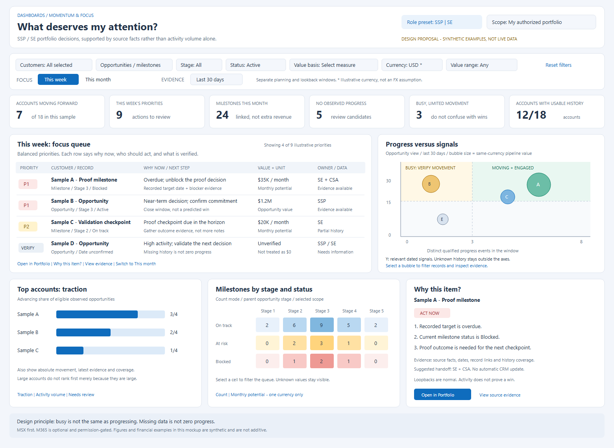

# Momentum & Focus Dashboard Proposal for SSPs and SEs

Status: **Proposal; dashboard implementation has not started.**

## Recommendation

Add **Momentum & Focus** as a new child tab of **Dashboards**, alongside the existing Seller,
Stage and Pipeline Review, and SE Reporting dashboards. Make it a decision dashboard:
**what is moving, what needs my attention, and why?** Not merely a count of CRM updates.

A shared browser-safe view and analytics contract are proposed for Desktop, Web, VS Code, and Teams.
This proposal was prepared from source-code inspection; no live business records were queried.
Saving this document does not authorize implementation.

[Editable SVG mockup](../media/momentum-focus-dashboard/momentum-focus.svg).
All figures in the mockup are synthetic and are not live portfolio results.

## Confirmed choices

- New dashboard tab, rather than crowding Seller Dashboard.
- Default scope: the signed-in user's current authorized portfolio, with a verified My work lens
  and a permitted Team lens where supported.
- MSX first; optional M365 enrichment in a later phase.
- Include private, permission-scoped history capture on refresh and authoritative history where available.
- Balanced priority emphasis: urgency, material impact, readiness, and SSP/SE relevance.

Proposed reviewable defaults: current calendar week/month in the user's timezone; a separate
trailing 30-day evidence window; 14-day inactivity and 30-day no-observed-progress review flags.
These are not universal business rules or declarations that an opportunity has failed.

## The seven questions, translated into the experience

| Requirement | User question | Proposed answer |
| --- | --- | --- |
| MF-001 | Which accounts/opportunities have the most traction? | Top Accounts bars and an opportunity momentum view, showing verified/observed progress, recency, and coverage. Show advancing share as well as counts so large accounts do not win merely by size. |
| MF-002 | What should I focus on this month? | A ranked monthly opportunity/milestone queue: target/close dates, commitments, blockers, material impact, suggested next action and accountable role. |
| MF-003 | What should I focus on this week? | A shorter actionable queue: overdue work, upcoming checkpoints, near-term blockers and items needing a decision or evidence check. |
| MF-004 | What is not progressing? | A Needs review lens distinguishing no observed movement, date slippage, blocked work, planned holds, normal stage loopbacks and insufficient history. |
| MF-005 | What is high-activity and signal-rich? | Deduplicated signal counts, type/source breadth, recency and an evidence timeline. Keep engagement distinct from progress. |
| MF-006 | Can I slice and dice? | Shared account/customer, opportunity, milestone, parent stage, entity-specific status, owner, dates, value basis/range, currency, role and source-quality slicers. |
| MF-007 | Can I see graphical charts? | Linked bubble/scatter, ranked bar, stage/status heatmap and deadline-distribution views, with accessible table equivalents. |
| MF-008 | Can the results be trusted? | Provenance, coverage, cold-start and uncertainty states; no fabricated history, zero-filled missing data or unsupported revenue claims. |
| MF-009 | Is scope and access preserved? | Caller-scoped data and history, no new CRM writes, no automatic sharing, and no role-picker privilege escalation. |
| MF-010 | Will this work consistently across the product? | One contract, one orchestrator capability, shared UI and four-host parity tests. |

## Proposed page

1. **Context and slicers**: SSP / SE preset, portfolio/My work/permitted Team scope, hierarchy,
   stage/status, value basis/currency and source coverage. Active filter chips and Clear selection.
2. **Two distinct clocks**:
   - **Focus horizon**: This week / This month / Custom, for priorities and deadlines.
   - **Evidence lookback**: 7 / 14 / 30 / 90 days, for activity and movement.
   Changing the focus horizon does not silently erase the retrospective evidence window.
3. **Clickable summary cards**: advancing accounts, weekly priorities, monthly milestones,
   review candidates, busy-without-verified-movement, and usable history/source coverage.
4. **Prominent priority queue**: entity, customer, stage/status, recorded date or explicitly proposed
   review date, value with its unit, priority tier, why now, evidence quality and next step.
5. **Graphical context**: the matrix and account bars explain the queue; the heatmap exposes
   concentrations. Selecting a mark cross-filters the corresponding records, with a visible reset.
6. **Why this item?** drawer: top reasons, source facts and dates, evidence references, history
   coverage, proposed owner/handoff, and safe links to Portfolio/MSX/existing advisory workflows.

Keep the existing dashboard default unchanged. Load the new dashboard only when visited.
On narrow screens, prioritize the queue and filter drawer; stack charts and retain native table scrolling.

### Chart specifications

| Visual | Encodings | Interaction and safeguards |
| --- | --- | --- |
| Progress versus signals matrix | X: distinct qualified progress events in the evidence window; Y: relevant dated signal count; bubble size: selected, same-currency value basis. Opportunity/milestone grain is explicit. | Moving + engaged, busy but not advancing, and quiet/review patterns. Unknown history is a separate list, not a dot at zero. Partial cohorts are labelled, not silently compared as complete. |
| Top Accounts bars | Advancing share of eligible active opportunities, with numerator/denominator, absolute progress count and latest movement. | Switch Traction / Activity / Needs review. Counts alone do not reward account size. Selecting an account narrows the linked hierarchy. |
| Stage x Status heatmap | Milestone count or verified monthly potential, by parent opportunity stage and milestone status. | Clicking a cell applies both dimensions. Count and monetary modes are never conflated; unknown stage/status remains visible. |
| Deadline distribution | Overdue / This week / Rest of month / Later / Undated, with opportunity and milestone series clearly separated. | Opens the relevant focus-queue subset. A recommended review date is not presented as a recorded CRM deadline. |

## Definitions and prioritization

### Do not collapse different questions into one opaque score

- **Activity volume**: distinct dated business activities/notes/tasks observed in the allowed sources.
  Exclude refreshes, agent runs, administrative noise and duplicate representations of the same activity.
- **Signal richness**: volume plus relevant type/source breadth, recency, reliable association and coverage.
  A note or record edit is evidence of activity, not automatically a positive customer outcome.
- **Traction**: supported movement toward an outcome: qualified readiness/stage change, meaningful
  milestone completion, a recorded commitment/decision or completed proof checkpoint where evidenced.
- **Stagnation**: a review candidate based on available history and context, not merely an old stage.
  Planned holds and long-cycle work need their next checkpoint considered.
- **Priority**: the action warranted now. A quiet but overdue material blocker can outrank a busy,
  healthy opportunity.

Use explainable **Act now / This week / Plan this month / Verify information** tiers in v1.
Within comparable records, order by urgency, role relevance, appropriate impact band, readiness and
evidence recency; keep tie-breaks deterministic. Do not mix monetary units or invent win probabilities.
Show the drivers and rule version rather than an unexplained 87/100 score.

For account traction, show the share of sufficiently observed active child opportunities advancing,
alongside the counts and coverage. Allow explicit activity-volume sorting as a different lens.
Repeated refreshes, reopenings, oscillating fields and date pushes must not inflate positive progress.

### SSP and SE presets

| Preset | Emphasis | Example next-step emphasis |
| --- | --- | --- |
| SSP | Commercial decisions, qualified pipeline, close/commitment windows and material blockers. | Confirm the decision/next commitment; resolve a commercial dependency; route stage-field work to the accountable Specialist. |
| SE | Technical proof/readiness, milestone outcomes, delivery feasibility and proof blockers. | Complete or re-scope proof; resolve a technical dependency; arrange the right CSA/CSAM/Specialist handoff. |

Role selection changes emphasis and explanation, never authorization. Important cross-role blockers
remain visible. MCEM is non-linear: a loopback is not a loss or automatic failure, and useful progress
can occur without changing the stage number.

## Financial and filter semantics

- Opportunity value is **pipeline value**, not recognized revenue, earnings or guaranteed credit.
- Milestone monthly usage/ACR potential is a **monthly rate**, not the same measure as opportunity value.
  Never add the two, and never multiply a parent opportunity value by its milestone count.
- Preserve source currency/unit. Aggregate one validated currency/basis at a time, or show separate
  groups; do not assume exchange rates or inherit a currency without verified attribution.
- Missing amounts/dates/status are explicit unknowns, not zeros. Undated or incomplete records can
  still need attention and must not disappear merely because a source mapping expects a close date.
- Stage on a milestone means its parent opportunity's stage. Status choices are entity-specific.
- Use canonical account/record IDs and verified membership/owner IDs, not name-only matching.
- Chart totals come from the complete filtered read model, not just the visible table page.
  If collection is partial or capped, qualify rankings and totals accordingly.

## What existing code supports, and what must be added

| Evidence from the repository | Consequence for this proposal |
| --- | --- |
| [dashboard-workspace.tsx](../../apps/shared/dashboards/dashboard-workspace.tsx) already hosts three shared dashboard tabs. | Add a lazy child tab and a typed invoke adapter; do not create four independent dashboards. |
| [Portfolio contracts](../../packages/common/contracts/index.ts) provide account/opportunity/milestone identifiers, current stage, dates, value, status, commitment and membership fields. | Current priorities are feasible, but these thin rows do not establish full historical progression. |
| [Connector interfaces](../../packages/connectors/common/index.ts) expose deeper opportunity evidence with dated comments, notes, activities, milestone tasks, gaps and retrieval health. | Reuse the read seams and source facts; validate what each timestamp actually represents. |
| [agent-evidence.ts](../../packages/orchestrator/agent-evidence.ts) intentionally caps prompt entries and milestones. | Do not rank the whole portfolio from an LLM-truncated evidence pack or treat its counts as complete analytics. |
| [Stage/Pipeline mapping](../../packages/connectors/msx/stage-pipeline-mapping.ts) can default unknown stage age to zero, and idle days are a conditional forecast-comment age. Its [collector](../../packages/connectors/msx/stage-pipeline.ts) also has scope exclusions. | Reuse validated source primitives, not those fields/subsets as universal proof of progress or inactivity. Preserve null/provenance in the new read model. |
| [Seller Dashboard](../Seller-Dashboard-Implementation.md) supports financial/current pipeline and some optional timestamps; its private quota/MINT workflow has different boundaries. | Do not require quota onboarding or borrow private earnings data for this dashboard. |
| [Graph evidence](../../packages/connectors/graph/se-evidence.ts) provides delegated M365 evidence primitives for another feature. | Phase-two reuse requires a capability/privacy review and reliable record association. Existing account-name matching alone is not proof of an opportunity link. |
| [operations.ts](../../packages/orchestrator/operations.ts) registers existing dashboard capabilities. | Add a single read-only operation family with versioned contracts and transport parity. |

This is a source-code feasibility assessment, not proof that every field, audit feed or M365 grant
is available in the user's live environment. No live/customer query was performed for this proposal.

## History and source honesty

- Prefer authoritative field/event history where access is already permitted. Do not enable CRM
  auditing, broaden grants or write to CRM as a side effect of opening a dashboard.
- Capture app-owned, minimal before/after observations on authorized refreshes. Record source event
  time separately from observation/ingestion time. A change detected between two observations has an
  interval; do not invent its precise occurrence time.
- A generic `modifiedOn`, edited comment or task due date is not a stage transition or task-completion date.
- First use shows **History available since...** and insufficient-history states. Do not backfill
  the last month from today's fields or paint an observation gap as flat historical performance.
- Explicit refresh capture is not continuous monitoring. Say **no observed progress** when that is all
  the evidence supports. Current due-date/blocked-item priorities remain useful during cold start.
- Prefer one principal-isolated history repository shared across the four surfaces. A local-only pilot
  must say **host-local history** and cannot claim cross-surface history continuity.
- Proposed retention is 180 days, subject to the existing data policy and approved secure store.
  Partition by tenant, principal, source identity and sample/live mode; deduplicate concurrent captures.
  Recheck current record access before exposing historical data.
- No customer history in browser localStorage, URLs or telemetry. No silent plaintext or sample fallback.

## Architecture and boundaries

Proposed browser-safe `momentum-focus` contract v1.0: query/filter windows, entity and monetary
semantics, canonical rows, chart series, priority reasons, evidence references, history provenance,
scope/completeness and source-health states. Parse at boundaries; add an independent contract rather
than breaking existing portfolio/Seller/Stage schemas.

One orchestrator service owns collection, history comparison, deduplication, ranking and aggregation.
Expose it through a single `momentumFocus` operation family such as get/refresh/detail. Caller identity
comes from the host, never from a role filter. Collect in bounded batches; avoid a full agent invocation
or an N+1 deep-evidence read per row on every filter change.

The shared UI only presents that read model. All four hosts marshal the same operation. Publish a
coherent result bundle with its filter/snapshot identity and per-source timestamps; reject stale
responses after scope changes, and clear inaccessible data when authorization changes.

MVP is read-only against business systems. No automatic task creation, CRM updates, notifications,
publishing, compensation calculations or additional LLM scoring. Existing reviewed actions/advisory
flows can be opened explicitly. M365 stays visibly unconnected until its separate integration is approved.

## Implementation outline and dependencies

These are proposed implementation tasks, not work authorized by saving this proposal.
Dependencies are recorded in the table so the document remains self-contained.

| Task | Work and key components | Depends on |
| --- | --- | --- |
| MP01 | Validate field provenance, source bounds, calendar/status mappings and secure shared-history storage; finalize the rule table and cold-start behavior. Anchor on the source files above. | None |
| MP02 | Add `packages/common/contracts/momentum-focus.ts`, canonical synthetic fixtures and contract tests, including nullable/unknown and financial-basis semantics. | MP01 |
| MP03 | Add bounded MSX collection plus a principal-isolated history repository/adapter, without CRM writes or forced audit access. Keep source and observation timestamps distinct. | MP02 |
| MP04 | Add pure analytics under `packages/orchestrator/momentum-focus/`: linked-scope filtering, event deduplication, priority tiers, account rollups and chart datasets. | MP03 |
| MP05 | Register the capability in `packages/orchestrator/operations.ts` and host composition; wire the existing Desktop/Web/VS Code/Teams invoke/data-client adapters. | MP04 |
| MP06 | Build focused browser-safe components under `apps/shared/dashboards/momentumFocus/` for filters, queue, charts, reasons and source/history states, initially against the contract fixtures. Reuse existing typography/themes. | MP02 |
| MP07 | Add the lazy tab in `dashboard-workspace.tsx`, wire the shared pane into all four hosts, and verify drill-through, scope resets, keyboard interaction and responsive layouts. | MP05, MP06 |
| MP08 | Run unit/contract, transport-parity, accessibility/static/interaction and surface e2e checks; update related docs/folder structure; verify sample/live boundaries and report source limitations. | MP07 |
| MP09 | Optional later M365 enrichment: explicit app grants, privacy/capability validation, minimal metadata, robust association/deduplication and no cross-user private-signal leakage. Not part of MSX-first MVP approval. | MP08 and separate approval |

MP06 can proceed independently of backend MP03-MP05 once MP02 is stable. Do not build a new frontend
stack, add a separate per-UI scoring engine, or couple this capability to the private MINT collector.

### Phased delivery, without fabricated completeness

1. **MSX-first decision view**: current priorities, structured signals, explicit history capture,
   source coverage and honest cold-start states.
2. **History-backed movement view**: trustworthy traction/stagnation comparisons as authoritative or
   sufficiently qualified history becomes available; keep observed and authoritative views distinct.
3. **Optional M365 enrichment**: additional context only after access and attribution have been proven.

## Acceptance and testing

- Each of the seven requested questions has a filterable view, a clear measure, and a way to inspect why.
- All four UIs return the same results for identical authorized inputs, history, clock, rules and filters.
  Different history availability is disclosed, never silently normalized.
- Weekly/monthly classifications handle timezone boundaries, date-only fields, month ends and DST.
- Generic edits, duplicate tasks, repeated refreshes, date pushes, reopenings and assistant usage do not
  manufacture progress. Legitimate MCEM iteration is not labelled a loss.
- Cold-start, undated, partial, denied, capped and stale inputs remain explicit. Unknown is not zero.
- Financial totals reconcile at the selected grain/currency/basis without parent-child double counting.
- User A cannot see user B's history/private signals; role/filter changes cannot widen authority.
- Charts cross-filter correctly, have keyboard/screen-reader alternatives, and remain usable on narrow
  Web/Teams/VS Code views. Aggregate values do not change merely because rows are paginated.
- The default suite uses one fixed-clock synthetic dataset and no live network/model calls.
  Include contrasting cases: advancing with modest activity, busy without movement, a quiet material
  blocker, a planned hold/loopback, incomplete coverage, and mixed currencies/value units.
- Use the repository's existing builds, unit/contract/parity tests and relevant UI smokes. Capture
  pre-existing gate failures separately; do not mask them or broaden this feature into unrelated cleanup.

## Requirement mapping

| Requirement | Tasks |
| --- | --- |
| MF-001 | MP01, MP02, MP03, MP04, MP06, MP07, MP08 |
| MF-002 | MP01, MP02, MP04, MP06, MP07, MP08 |
| MF-003 | MP01, MP02, MP04, MP06, MP07, MP08 |
| MF-004 | MP01, MP02, MP03, MP04, MP06, MP08 |
| MF-005 | MP01, MP02, MP03, MP04, MP06, MP08, optional MP09 |
| MF-006 | MP02, MP04, MP06, MP07, MP08 |
| MF-007 | MP02, MP04, MP06, MP07, MP08 |
| MF-008 | MP01, MP02, MP03, MP04, MP06, MP08 |
| MF-009 | MP01, MP02, MP03, MP05, MP07, MP08, optional MP09 |
| MF-010 | MP02, MP04, MP05, MP06, MP07, MP08 |
