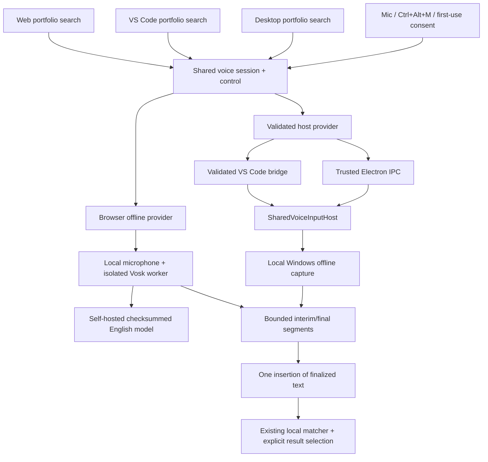

# Voice Input in Portfolio Search: Design and Implementation

## Status and provenance

Implemented in the current worktree following the user's 2026-10-10 instruction
to continue autonomously and resolve platform blockers.

The original research report was retrieved from the 2026-10-09 voice-input
research session. It inspected commit
`11ba15e0b6197a2c53cb548658c5974967b853c6`; this implementation starts from
`de759a108bcafb33041557f8d06cb5843489d369`. The original was a session artifact,
not a committed repository document. This document preserves its core decisions
and records the necessary provider-design adjustment and actual tests.

## Original requirements retained

- Voice targets **Search accounts and opportunities**, not Agent task composition.
- Desktop/Web share the revamp renderer; VS Code uses its own portfolio-search
  component. Both retain the existing trimmed, case-insensitive substring matcher
  and eight-result limit.
- Mic or foreground **Ctrl+Alt+M** toggles capture. No wake word, OS-global
  shortcut, background listening, auto-submit, agent invocation, or data write.
- First-use disclosure and explicit consent; English (U.S.); offline sample/live
  parity; no silent cloud fallback.
- Query is unchanged while speech appears in a separate preview. Finalized speech
  is inserted exactly once at the captured caret/selection. User reviews/edits,
  then uses normal Enter/result selection.
- Manual edits, paste, selection changes, navigation, blur, hidden view and loss
  of foreground cancel; callbacks from previous generations cannot resurrect text.
- Preserve idle UX differences: VS Code Escape/outside blur clear the query,
  Desktop/Web outside blur do not. Do not capture into the hidden narrow Desktop/
  Web field. The legacy Desktop renderer is out of scope.
- Exact limits: 30 seconds audio, 10 seconds speech inactivity, 2,000 transcript
  characters, 64 segments, one-second finalization. Never silently truncate or
  treat interim words as finalized.
- Accessible native non-submit mic button, pressed state, status/error
  announcements, separate non-live per-word preview.

## Why the renderer-only candidate changed

Official Electron source/tests deliberately report on-device Web Speech as
unavailable:
[Chromium tests](https://github.com/electron/electron/blob/main/spec/chromium.spec.ts)
and [browser implementation](https://github.com/electron/electron/blob/main/shell/browser/electron_browser_client.cc).

Stable VS Code has no supported webview microphone opt-in. Both missing iframe
delegation and media permission denial are documented by
[microsoft/vscode#323602](https://github.com/microsoft/vscode/issues/323602).
The installed runtime's webview allow list confirms that a CSP edit alone does
not grant microphone access.

Consequently the implementation uses the installed **Windows offline speech
engine** in local Desktop/VS Code hosts, not a browser API that cannot work.
Web uses **Vosk WASM** on the browser device. Host permissions/sandbox remain
intact; remote VS Code capture and Web-server microphone capture are prohibited.
The user explicitly requested continued implementation after these findings.

## Architecture

### Files and boundaries

| Layer | Implementation |
|---|---|
| Contracts | [voice.ts](../../packages/common/contracts/voice.ts): strict independent `voiceContractVersion = 1.0`, availability, requests, events, segments and responses |
| Shared native harness | [SharedVoiceInputHost](../../packages/orchestrator/voice-input.ts): operation validation, single ownership, bounds, correlation, cancellation/generation and finalization |
| Native adapter | [Windows capture](../../packages/connectors/common/windows-voice.ts): safe fixed PowerShell program, offline `System.Speech`, JSON-only bounded events, no shell interpolation or audio persistence |
| UI controller | [Session logic](../../apps/shared/voice-input.ts), [React binding](../../apps/shared/use-voice-dictation.ts), [control](../../apps/shared/voice-search-control.tsx) |
| UI providers | [Native host adapter](../../apps/shared/host-voice-provider.ts), [browser provider](../../apps/shared/browser-voice-provider.ts) |
| Desktop/Web UI | [Extracted search](../../apps/desktop/renderer-revamp/src/portfolio-search.tsx); App no longer owns the search form/query |
| VS Code UI | [PortfolioSearch](../../apps/vscode-extension/src/webview/portfolio-search.tsx), browser-safe direct contract import (no Node barrel) |
| Transports | [IPC](../../apps/desktop/electron/main/voice-ipc.ts), [webview routing](../../apps/vscode-extension/src/voice-bridge.ts), [HTTP](../../apps/web/src/app.ts) |
| Model/build | [Model preparation](../../scripts/prepare-voice-model.mjs), [worker extraction](../../scripts/voice-worker-assets.mjs) |

The standalone voice contract is additive: existing backend/meeting/workflow
wire formats and their versions are unchanged. The same native operations
`availability/start/read/stop/cancel` validate identically on IPC, HTTP and the
webview bridge. Production HTTP explicitly reports that Web capture belongs in
the browser and cannot start the server microphone.

## Provider behavior and privacy

Windows has general dictation plus at most 64 visible portfolio names as local
recognition vocabulary hints. Recognized words are untrusted search input, not
commands. The fixed helper has no path/audio override in production requests;
prerecorded file injection exists only in tests.

Web runs open dictation plus bounded local portfolio vocabulary decoding. The
English model is bundled after SHA-256 verification. During warm-up, at most
10 seconds of audio is held in memory so first words are not dropped. Both
model/recognizer resources and microphone tracks are released on cancellation;
late permission grants are stopped, not attached to a canceled view.

The application page retains **no `unsafe-eval`**. Build-time extraction moves
the pinned library's Emscripten worker into a separate same-origin static asset;
only that worker has the required dynamic-code-generation policy. Worker
connections are self-only; no third-party speech endpoints are allowed.

No raw audio/query/portfolio names/tokens are logged. No microphone recordings
are saved. Native process errors use fixed non-content-bearing messages.
Native capture is available only in a local Windows extension host; remote
windows deliberately show voice unavailable rather than access a remote machine's
microphone. The extension's existing host placement is unchanged.

## Test evidence

Three original, sanitized statements are synthesized into 16 kHz PCM16 mono WAV:

1. `grid operations modernization`
2. `clinical data platform`
3. `review the renewal opportunity`

[Fixture manifest](../../tests/fixtures/voice-input/statements.json),
[recordings](../../tests/fixtures/voice-input/recordings), and
[generation utility](../../scripts/create-voice-test-recordings.ps1).
No person's voice or customer recording was used.

Initial unrestricted Windows dictation produced 66.7%, 100%, and 75% word accuracy
respectively, and failed the proposed per-statement 75% qualification. Those
results were not replaced with scripted transcripts. The production vocabulary
hint path was then exercised with real audio: all three engine tests passed.
UI tests preserve actual provider capitalization/wording, not fabricated text.

| Evidence | What it verifies |
|---|---|
| [Session tests](../../tests/unit/shared/voice-input-session.test.ts) | Exact limits, one insertion, interim replacement, duplicates/sequences, cancel/manual text, stale events, synchronous providers |
| [Host tests](../../tests/unit/orchestrator/voice-input.test.ts) | Concurrent owners, cancellation during availability, visible foreground gate, bounded results/finalization |
| [Transport parity](../../tests/unit/hosts/voice-transport-parity.test.ts) | Identical operations, strict consent/version/path rejection, HTTP auth and cross-origin denial, no server capture |
| [Resource tests](../../tests/unit/shared/browser-voice-provider.test.ts) | Bounded warm-up, audio-only request, one track close, late permission release, explicit model failure |
| [Native audio](../../tests/unit/connectors/windows-voice.test.ts) | Same production engine reads actual WAV (opt-in in default unit suite) |
| [Web audio](../../tests/e2e/revamp/web-voice.spec.ts) | Real microphone test-file input, Vosk processing, no external calls, production CSP, hidden search, denial, explicit selection |
| [Desktop audio](../../tests/e2e/revamp/desktop-voice.spec.ts) | Actual Electron/preload/UI with production native recognizer supplied recorded audio |
| [VS Code bridge](../../tests/e2e/revamp/vscode-voice.spec.ts) | Actual native audio plus validated bridge and deterministic edit/Escape/blur/hotkey interactions |
| [Real VS Code](../../tests/e2e/revamp/vscode-real-voice.spec.ts) | Isolated installed VS Code host, actual webview, Ctrl+Alt+M, all three recordings through production helper and explicit query selection |

Chromium fake audio uses `%noloop`, verified from official Chromium switch
documentation, so repeated recordings are not mistaken for duplicate provider
events. Browser audio/header scenarios were run twice consecutively.

Validation completed:

- `phase0:check`: 105 test files, 588 tests passed; three prerecorded native cases
  remain opt-in in the default unit suite.
- `validate:major`: passed, including the existing secure Desktop smoke.
- `test:smoke:revamp`: all 49 journeys passed, including voice and existing UI
  regressions.
- All three surface builds and dedicated extension typecheck/lint passed.
- Opt-in native recording tests: all three actual WAV statements passed.
- Browser audio and production-header cases: passed twice consecutively.
- Real installed VS Code 1.141.0 host/webview/hotkey passed all three recordings.
- Desktop recorded-audio journeys also passed on the exact pinned Electron
  43.5.0 binary. The full legacy/revamp suite used the installed Electron 43.4.0
  dependency while registry restoration was unavailable.

Hardware microphone drivers/OS privacy policies are device-specific; tests use
the real engines with prerecorded audio rather than secretly recording a person.

## User documentation and remaining scope

[Voice search guide](../user-guide/VOICE-SEARCH.md) covers activation, consent,
engines, offline/sample behavior, errors, language installation and testing.

The build downloads public model assets once, not live audio. The environment's
pre-existing locked dependency restore failed (mirror HTTP 404/public TLS and
unavailable MCP version); installed build tools were reused read-only through
worktree-local links, with the added Vosk dependency installed in session storage.
No other checkout or dependency versions were edited as a workaround.

Remote VS Code, non-Windows native capture, other languages, legacy Desktop,
Agent composer, milestone/opportunity notes, task/feedback fields, stage reasons,
discovery/Plays filters, live meeting capture and TTS remain separate future work.
They must retain their existing explicit Save/Send/Approve gates.
