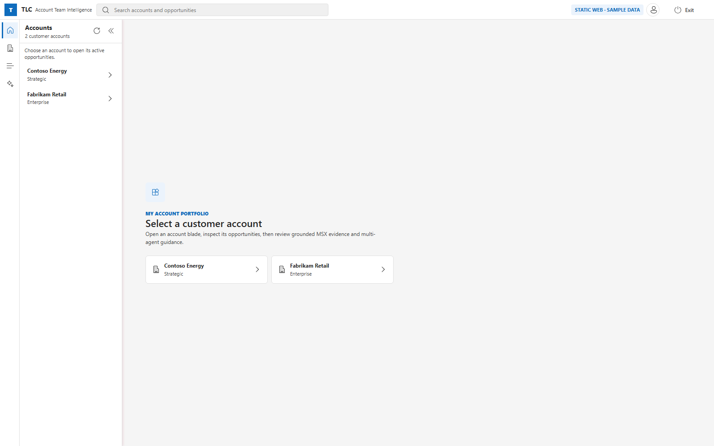
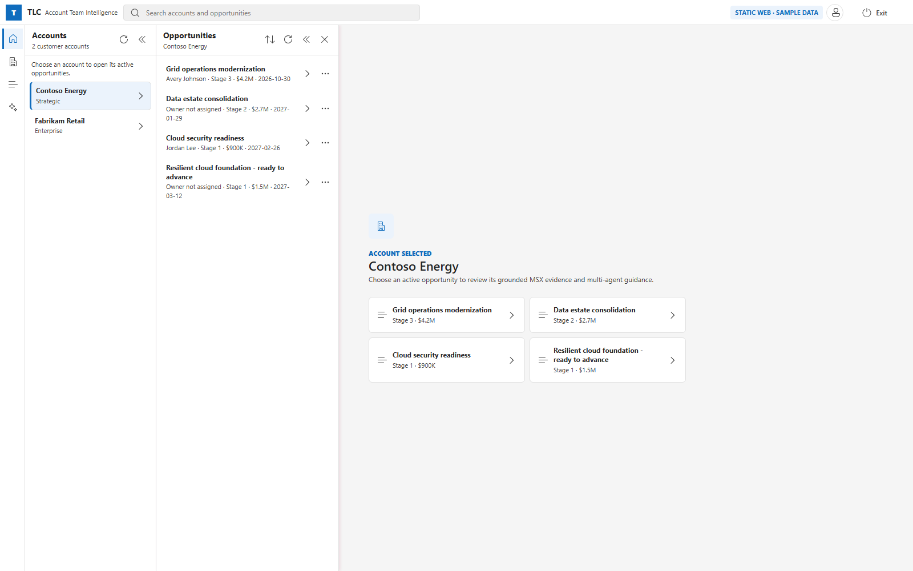
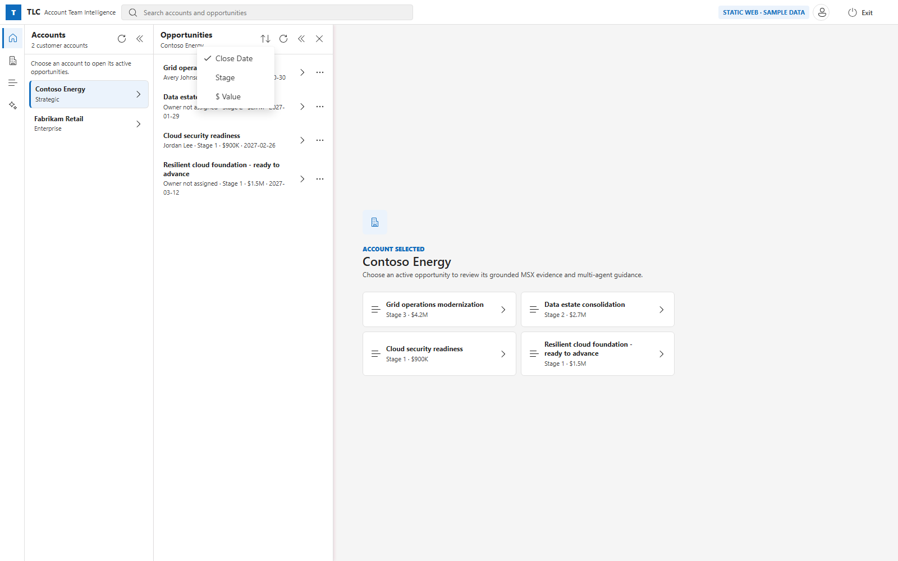
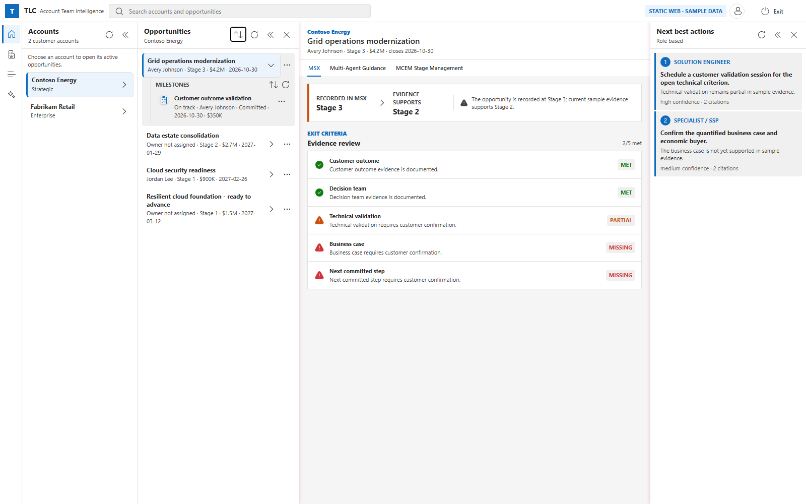
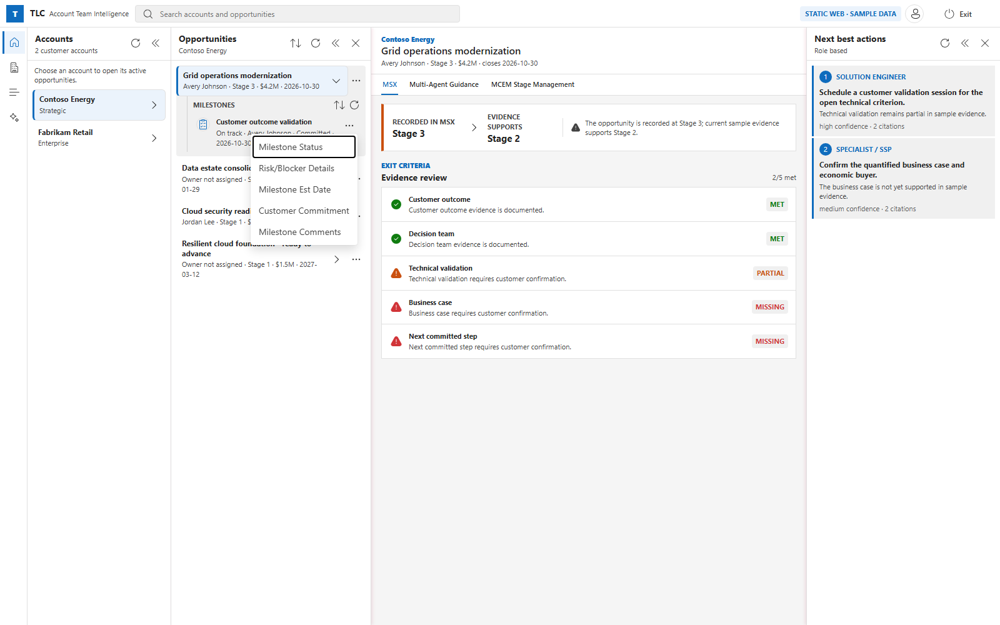
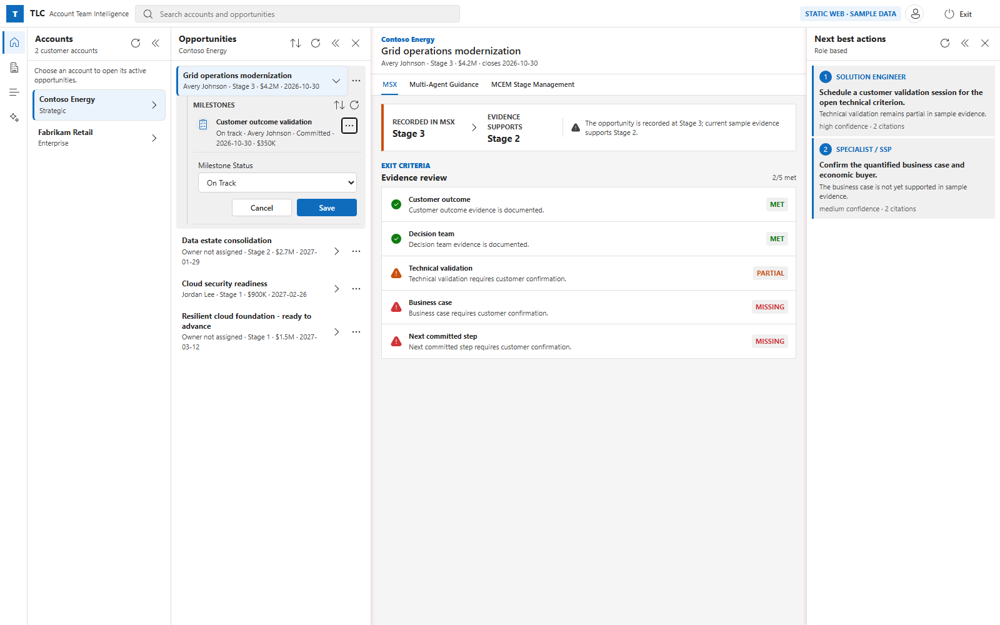
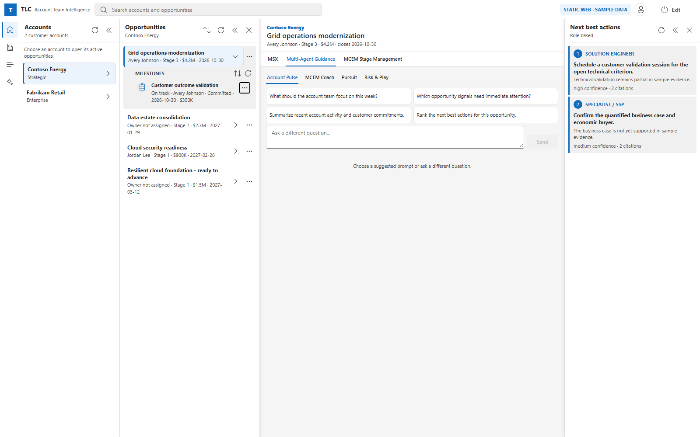
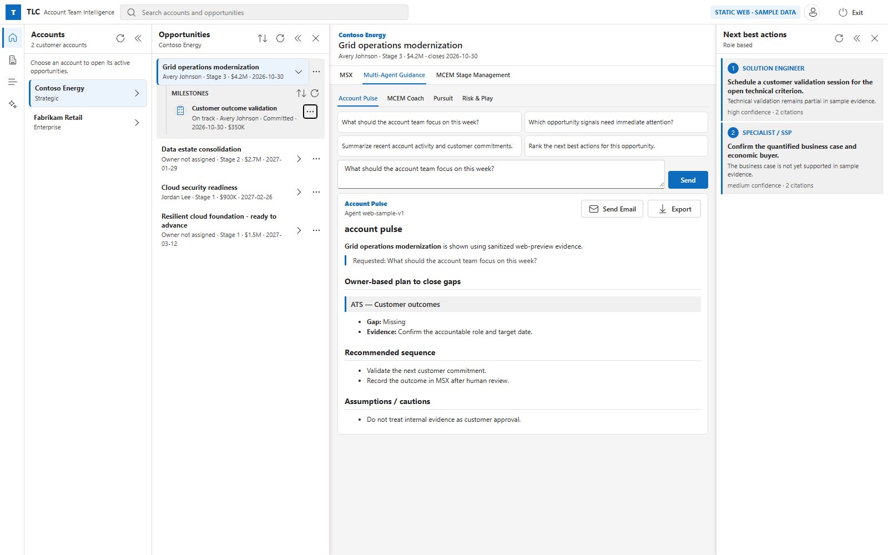
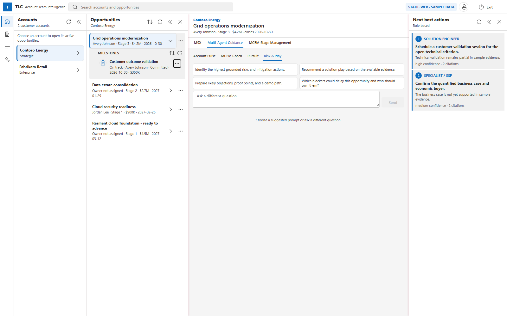
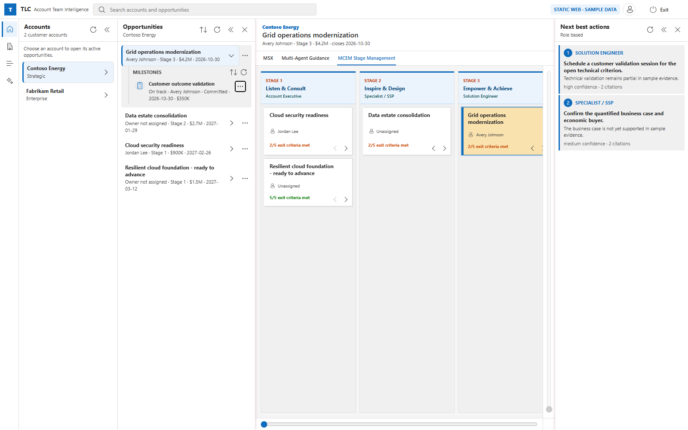

# TLC Multi-Agent Assist — User Guide

TLC Multi-Agent Assist is a role-aware account team assistant. It joins live MSX opportunity data with grounded internal knowledge and four specialized agents that translate evidence into next-best actions.

It ships as two end-user surfaces that share the same feature set — a **VS Code shell extension** and a **Windows desktop application** (the same experience is also hosted as a web app). The two surfaces differ in look and feel, so each part has its own screenshots. This guide is organized into those two parts:

- **[VS Code Shell Extension](#vs-code-shell-extension)** — install, open, and use TLC Assist inside VS Code, with VS Code-specific screenshots.
- **[Desktop Version](#desktop-version)** — install, launch, and run the Windows desktop app, with the full illustrated feature walkthrough.

All screenshots come from the sanitized sample dataset shipped with the product. Portfolio live data is pulled from MSX for opportunities on which you are on the deal team. The separate Seller Dashboard uses the seller's own official quota-account scope and requires its own authorized source setup.

---

## Table of contents

**[Part 1 — VS Code Shell Extension](#vs-code-shell-extension)**

- [Install and open in VS Code](#install-and-open-in-vs-code)
  - [The New, Discover, Portfolio, Plays, and Dashboard tabs](#the-new-discover-portfolio-plays-and-dashboard-tabs)
  - [Run the extension in sample mode](#run-the-extension-in-sample-mode)
- [The VS Code experience](#the-vs-code-experience)

**[Part 2 — Desktop Version](#desktop-version)**

- [Install and launch the desktop app](#install-and-launch-the-desktop-app)
- [Run the desktop app with sample data](#run-the-desktop-app-with-sample-data)
- [New Opportunity and Milestone creation](#new-opportunity-and-milestone-creation)
  - [Enable SQLite saving](#enable-sqlite-saving)
  - [Create an Opportunity with child Milestones](#create-an-opportunity-with-child-milestones)
  - [Import multiple Opportunities and Milestones from CSV](#import-multiple-opportunities-and-milestones-from-csv)
  - [Add Milestones to an existing Opportunity](#add-milestones-to-an-existing-opportunity)
  - [When Submit to SQLite is missing](#when-submit-to-sqlite-is-missing)
1. [The workspace at a glance](#2-the-workspace-at-a-glance)
2. [Accounts blade — curating and selecting accounts](#3-accounts-blade--curating-and-selecting-accounts)
3. [Opportunities blade — reviewing your book of work](#4-opportunities-blade--reviewing-your-book-of-work)
   1. [Sorting opportunities](#41-sorting-opportunities)
   2. [Editing opportunity comments](#42-editing-opportunity-comments)
4. [Milestones — drilling down inside an opportunity](#5-milestones--drilling-down-inside-an-opportunity)
   1. [Sorting milestones](#51-sorting-milestones)
   2. [Editable milestone fields](#52-editable-milestone-fields)
5. [MSX evidence panel](#6-msx-evidence-panel)
6. [Agentic guidance — the four agents](#7-agentic-guidance--the-four-agents)
   1. [Account Pulse](#71-account-pulse)
   2. [MCEM Coach](#72-mcem-coach)
   3. [Pursuit / Executive](#73-pursuit--executive)
   4. [Risk & Solution Play](#74-risk--solution-play)
   5. [Working with an agent response](#75-working-with-an-agent-response)
7. [MCEM Stage Management](#8-mcem-stage-management)
8. [Next-best actions rail](#9-next-best-actions-rail)
9. [Search](#10-search)
10. [Data modes and the top-right badge](#11-data-modes-and-the-top-right-badge)
11. [Exiting the app](#12-exiting-the-app)

---

# VS Code Shell Extension

TLC Assist installs as a self-contained VS Code extension and opens inside the editor. Everything in this part — accounts, opportunities, milestones, the four guidance agents, and the MCEM board — is the same feature set delivered in the [Desktop Version](#desktop-version).

## Install and open in VS Code

1. Install `tlc-assist-vscode-<version>.vsix` from the GitHub Releases page (see the [VS Code extension install guide](VSCODE-EXTENSION-INSTALL.md) for the full steps). Only **VS Code / VS Code Insiders 1.90.0+** is required — no Node.js, npm, sign-in, or network.
2. Run **Developer: Reload Window**, then select the **TLC Assist** icon in the Activity Bar, or run **TLC: Open Assist** from the Command Palette (`Ctrl+Shift+P`).

The extension starts in **sample** mode (sanitized fixtures, no network). To use live data, run **TLC: Use Live Data (MSX/Dataverse)** from the Command Palette (or set `tlc.mode` to `live` in **Settings**) and sign in with VS Code's built-in Microsoft account. The same provider supplies delegated tokens for MSX and Foundry.

### Switching the data source (sample, SQLite test store, or live)

Two independent toggles control where data comes from:

| Toggle | Setting | Values |
| --- | --- | --- |
| **Mode** | `tlc.mode` | `sample` (sanitized, offline) · `live` (MSX OData + Dataverse MCP) |
| **Sample data store** | `tlc.dataStore` | `fixture` (in-memory) · `sqlite` (file-backed SQLite test store; submitted records survive VS Code restarts). Applies only in sample mode. |

- **Switch sample ⇄ live at runtime** from the Command Palette (`Ctrl+Shift+P`): **TLC: Use Live Data (MSX/Dataverse)** or **TLC: Use Sample Data**. The status bar flips between `TLC Assist: Live` and `Sample`, and the panes reload.
- **TLC: Test Live Connection** only *verifies* connectivity to Dataverse — it does **not** switch the data source. Use **Use Live Data** to actually switch.
- You can also set `tlc.mode` / `tlc.dataStore` in **Settings** (`Ctrl+,`, search "tlc").
- **Live requires sign-in:** VS Code's Microsoft account (`@microsoft.com`) must have access to MSX and the configured Foundry project. If a delegated token cannot be acquired, the extension shows an error toast and stays on sample — see **Output → TLC Assist** for details.

> **Developing with F5?** The repo includes Extension Development Host launch configs — **Run TLC Assist Extension** (fixtures), **(SQLite test store)**, and **(Live MSX/Dataverse)** — that set the startup data source. After rebuilding the extension, run **Developer: Reload Window** in the Extension Development Host (or relaunch) so the new build loads before switching modes.

In Sample SQLite, **New** supports Opportunity and Milestone forms and CSV import.
**Validate & load CSV** only fills the draft; choose **Validate & review** and
then **Submit to SQLite** to save it. The file is under the extension's local
storage (or at the explicitly configured `TLC_DATA_STORE_PATH`); it is separate
from Desktop and Web Sample files. Fixture and Live modes only export drafts
and never create live MSX Opportunities or Milestones.
See [New Opportunity and Milestone creation](#new-opportunity-and-milestone-creation)
for the complete form, CSV import, review, and submission walkthrough.

### The New, Discover, Portfolio, Plays, and Dashboard tabs

The TLC Assist view is organized into these tabs:

- **New** — prepare Opportunities and Milestones using forms, grids, or CSV import, then review and submit to the SQLite sample store or export a no-write draft.
- **Discover** — browse Solution Engineer domains and join or leave opportunity Deal Teams.
- **Portfolio** — your accounts, opportunities, milestones, MSX evidence, and the four guidance agents, with **Email** and **Word** export on every agent response.
- **Plays** — the operational Plays catalog in the left rail (ordered by workflow number) and the Operational Queue of results. Each queue item can be dispatched to an agent — for example **Send to Pursuit** or **Send to Risk & Play** — and the returned response can be exported with **Email** or **Word**, just like Portfolio guidance.
  Live results appear as pages arrive, with an explicit incomplete/loading message.
  Wait for the run to finish before sending an item to an agent. A partial result
  (including the 100-row live read limit) is not complete portfolio coverage.
  Plays allow up to 60 seconds for execution; a failure or cancellation never
  marks already displayed partial rows as completed.
- **Seller Dashboard** — a separate, read-only four-section performance report with fixed official attainment, account gaps, pipeline hygiene, consumption and U2C evidence. It adds no financial export/sharing controls; unavailable live sources remain unknown. See the [Seller Dashboard guide](SELLER-DASHBOARD.md) for filters, methodology and protected local-live setup.
- **Stage and Pipeline Review** — a second Dashboards tab: consumption opportunities by stage with scope toggles, filters, alert cards, an ACR Actuals and Outlook chart and a milestone view. Read-only and currently sample-data only; see the [Stage and Pipeline Review guide](STAGE-PIPELINE-REVIEW.md).
- **SE Reporting Dashboard** — a sibling under **Dashboards** for manager-scoped monthly pod reports: live-contract/profile setup, verified assignments, draft generation, reporter-owned asks, and reviewed JSON/HTML output. It does not change Seller Dashboard or CRM records. See the [SE Reporting Dashboard guide](SE-REPORTING-DASHBOARD.md).

VS Code also contributes a native **TLC Assist** tree and toolbar commands (**TLC: Refresh Data**, **TLC: Add Customer Account**, **TLC: Toggle Hidden Customers**).

### Run the extension in sample mode

Sample mode is the default and needs nothing else — no sign-in, no network, no Azure CLI. If you previously switched to live mode, run **TLC: Use Sample Data** (or set `tlc.mode` back to `sample` in **Settings**). In sample mode the view loads bundled sanitized data (or the SQLite test store when `tlc.dataStore` is `sqlite`) and never calls MSX or Foundry.

## The VS Code experience

The VS Code extension renders TLC Assist inside the editor, so its chrome — the Activity Bar icon, the editor tab, the native tree, and the VS Code theme — looks and feels different from the standalone desktop window even though the features are the same. The screenshots below are captured from the **Extension Development Host** running in sample mode.

> 📸 **Screenshot to add** — `./media/vscode/01-portfolio.png`: the TLC Assist view open on the **Portfolio** tab, showing the account portfolio, a selected opportunity, and its milestone tree.

> 📸 **Screenshot to add** — `./media/vscode/02-guidance.png`: a completed **Multi-Agent Guidance** response on the Portfolio tab with the **Email** and **Word** buttons visible.

> 📸 **Screenshot to add** — `./media/vscode/03-plays-queue.png`: the **Plays** tab with the catalog rail ordered by workflow number and the Operational Queue, including a **Send to Pursuit** action on a queue item.

> 📸 **Screenshot to add** — `./media/vscode/04-plays-guidance.png`: a Plays queue item dispatched to an agent, showing the returned response with its **Email** and **Word** export buttons.

For the full, step-by-step tour of every feature — accounts, opportunities, milestones, MSX evidence, the four agents, the MCEM board, next-best actions, and search — see the illustrated walkthrough in [Desktop Version](#desktop-version); the behavior is identical in VS Code.

---

# Desktop Version

The Windows desktop application is a standalone Electron window that delivers the same account-team and guidance features as the VS Code extension, with its own look and feel. This part covers desktop install, launch, and sample mode, and then walks through every feature with desktop screenshots. The feature behavior is identical in the [VS Code Shell Extension](#vs-code-shell-extension).

## Install and launch the desktop app

1. Download the Windows installer (`TLC-MultiAgent-Assist-<version>-Windows-x64.exe`) or the portable ZIP from the [latest release](https://github.com/kprpg/TLC-MultiAgentAssist/releases/latest), unblock it, and run it. See the [complete desktop installation guide](DESKTOP-INSTALL.md) for detailed steps and troubleshooting.
2. Launch **TLC Multi-Agent Assist** from the Start Menu. The desktop app opens your system browser for Microsoft sign-in when live mode first needs a resource token.

After sign-in you land on the empty workspace with your account portfolio in the left blade; no account is opened until you select one.



## Run the desktop app with sample data

> **Use sample mode to explore the application without signing in or connecting to MSX, Foundry, Azure, or Microsoft Entra ID.** Close any running instance of TLC Multi-Agent Assist first.

From **Windows Command Prompt** (`cmd.exe`) at the repository root, run:

```cmd
set "TLC_DATA_MODE=sample" && ".\release\win-unpacked\TLC MultiAgent Assist.exe"
```

After downloading the Windows `.exe` from the GitHub Release page and installing it, replace `<UserName>` with your Windows user name, open **Windows Command Prompt** (`cmd.exe`), and run:

```cmd
set "TLC_DATA_MODE=sample" && "C:\Users\<UserName>\AppData\Local\Programs\TLC MultiAgent Assist\TLC MultiAgent Assist.exe"
```

If you downloaded the portable ZIP, extract it, open Command Prompt in the extracted folder, and run:

```cmd
set "TLC_DATA_MODE=sample" && "TLC MultiAgent Assist.exe"
```

Keep the quotes around `TLC_DATA_MODE=sample`. In Command Prompt, an unquoted command such as `set TLC_DATA_MODE=sample && ...` stores a trailing space in the value and causes the app to start in live mode.

For PowerShell, run:

```powershell
$env:TLC_DATA_MODE = 'sample'
& "$env:LOCALAPPDATA\Programs\TLC MultiAgent Assist\TLC MultiAgent Assist.exe"
```

Sample mode loads bundled sanitized data and opens the workspace directly without displaying a login dialog.

## Resize Portfolio panes and scroll wide content

In VS Code, Desktop, Web, and Teams, drag the **three-dot grip** between visible
Portfolio panes to change their widths. A blue vertical line appears on hover,
keyboard focus, and while dragging. Focus a divider and use **Left/Right Arrow**
to adjust it, **Shift+Arrow** for larger steps, or **Home/End** for its limits.
Double-click the divider to restore its default width.

Existing show/hide controls still work, and Teams keeps unsent drafts when a pane
is hidden. Dividers disappear when the layout stacks on a narrow screen.
Desktop/Web retain their existing saved blade widths; VS Code and Teams keep
widths for the current mounted Portfolio workspace.

Wide tables and pane content have a **horizontal scrollbar at the bottom** when
needed. Drag the scrollbar to reach off-screen columns; this scrolls content
without changing pane height or selected records.

## New Opportunity and Milestone creation

The **New** tab, immediately before **Discover**, provides the same creation flow in Desktop,
the VS Code extension, and the hosted Web app. It creates records only in the sanitized
SQLite sample store. **Live MSX Opportunity and Milestone creation is disabled.**

| Creation type | Use it for | Entry options |
| --- | --- | --- |
| **Opportunity** | One new Opportunity for the selected Account, with optional child Milestones. | Form and **Add Milestone**. |
| **Multiple Opportunities** | Several new Opportunities for one Account, each with its own child Milestones. | Repeated forms, **Grid**, or **Import CSV**. |
| **Milestone** | One or more new Milestones under an existing authorized Opportunity in the selected Account. | Repeated forms, **Grid**, or Milestone CSV import. |

### Enable SQLite saving

**Sample mode alone is not enough: select the SQLite sample data store as well.** After
choosing an Account in **New**, verify that **Save target** is **SQLite sample store**.
Choosing **Draft only** deliberately disables database submission.

| Surface | Required settings | Where submitted records are kept |
| --- | --- | --- |
| **VS Code / VS Code Insiders** | `tlc.mode = sample` and `tlc.dataStore = sqlite`. | `sample.sqlite` in that editor profile's extension storage. |
| **Desktop** | `TLC_DATA_MODE=sample` and `TLC_DATA_STORE=sqlite` before launch. | `sample.sqlite` in Electron's per-user application-data directory. |
| **Hosted Web** | `TLC_WEB_MODE=sample` and `TLC_DATA_STORE=sqlite` before starting the host. | Set `TLC_DATA_STORE_PATH` to a writable file for persistence; without it, the non-demo host uses an in-memory SQLite store. |

For the extension, merge these settings into the workspace's `.vscode/settings.json`:

```json
{
  "tlc.mode": "sample",
  "tlc.dataStore": "sqlite"
}
```

Install the current VSIX, then run **Developer: Reload Window**. Stable VS Code and
VS Code Insiders are separate installations; update and reload whichever editor you use.
For an F5 development session, choose **Run TLC Assist Extension (SQLite test store)**.
See the [extension build and install guide](VSCODE-EXTENSION-CLI.md).

For source builds, run `npm run desktop:start:sqlite` or `npm run web:start:sqlite` from
the repository root. For the portable Desktop demo, run:

```powershell
& .\docs\demo-launchers\Launch-ReleaseDesktopDemo.ps1
```

The [portable demo launcher](../demo-launchers/Launch-ReleaseDesktopDemo.ps1) starts both
Live and Sample windows; use the **Sample** window for creation. It prints the SQLite
file path and, unless overridden, saves to
`%LOCALAPPDATA%\TLC MultiAgent Assist\desktop-demo-sample.sqlite`. The installed Desktop
demo launcher uses that same file. The local Web demo uses a separate
`web-demo-sample.sqlite` file. `TLC_DATA_STORE_PATH` can explicitly override the store path.

**Desktop, VS Code, and Web sample databases do not synchronize.** Submitted records
survive restarts when you reopen the same file-backed store. Look in the same surface
and editor profile where you submitted them.

### Create an Opportunity with child Milestones

1. Open **New > Opportunity**, choose the **Account**, and verify the SQLite save target.
2. Enter **Opportunity name**, **Opportunity Intent**, **Estimated value**, and
   **Estimated close date**. Confirm the **Price List**, **Currency**, and **Owner**;
   defaults come from the selected Account's creation catalog. Add **Need**,
   **Solution Area**, or **Technical Capability** when useful.
3. Select **Add Milestone** for each child. Enter **Milestone name**, **Milestone category**,
   **Milestone estimated date**, and **Workload**. Set the owner, status, commitment,
   estimated monthly usage, budget approval, and comments as needed. **At Risk** and
   **Blocked** statuses require **Risk/Blocker details**. Child Milestones inherit the
   Opportunity's currency.
4. Select **Validate & review**. Check the Account, save target, Opportunity and child
   fields, dates, currency, and planned mutation count. Use **Edit** to make corrections,
   then validate again.
5. Select **Submit to SQLite** on the review screen. After the success message, select
   **View in Portfolio** to open the created Opportunity and its Milestones.

For several Opportunities under the same Account, choose **Multiple Opportunities**.
Use **Add Opportunity** in the form or grid, or **Duplicate Opportunity** in the grid,
then edit each row and its child Milestones. **Edit details** returns from the grid
to the complete forms. Review and submit the entire batch together.

### Import multiple Opportunities and Milestones from CSV

The importer uses separate Opportunity and Milestone files, not a combined CSV. Try the
sanitized Fabrikam Retail example:

- [opportunities.csv](../../tests/fixtures/record-creation/multiple-opportunities-multiple-milestones/opportunities.csv)
- [milestones.csv](../../tests/fixtures/record-creation/multiple-opportunities-multiple-milestones/milestones.csv)

1. Open **New > Multiple Opportunities** and select **Fabrikam Retail**.
2. Check that **Save target** is **SQLite sample store**, then choose **Import CSV**.
3. Select the linked files in **Opportunities CSV** and **Milestones CSV**.
4. Select **Validate & load CSV**. The imported Opportunities appear in the editable grid;
   use **Edit details** to inspect their child Milestones. **No records have been saved yet.**
5. Select **Validate & review** and inspect the complete batch.
6. Select **Submit to SQLite**, wait for the success message, then **View in Portfolio**.

This sample creates:

| Opportunity | Child Milestones |
| --- | --- |
| AI-assisted retail service | Retail service AI pilot; Retail service AI production. |
| Unified commerce modernization | Commerce target design; Commerce production launch. |
| Retail cloud security modernization | Cloud security baseline; Cloud security rollout. |

Expected result: **3 Opportunities, 6 Milestones, and 3 creator Deal Team memberships**.
The review shows **12 planned mutations**.

For your own files:

- Select the Account in the UI; it is not a CSV column.
- Give each Opportunity a unique `clientOpportunityKey` and each Milestone a unique
  `clientMilestoneKey`. Each Milestone's `parentOpportunityKey` must match its new parent's
  `clientOpportunityKey`. These are import correlation keys, not Dataverse record IDs.
- Use ISO dates (`YYYY-MM-DD`) and plain numbers without currency symbols or thousands
  separators. Use `|` for multiple Opportunity Intent labels, such as `Billed|Consumption`.
- Preserve the template headers and use lookup IDs and exact choice labels available in
  the current catalog. Use standard CSV quoting for cells containing commas.
- The Milestone CSV is optional for an Opportunity-only batch. For the example above,
  choose both files to include the children.

The [CSV/JSON fixture reference](../../tests/fixtures/record-creation/README.md) also
includes a Contoso Energy example with one Opportunity and several child Milestones.
To import that pair, use **Multiple Opportunities** even though it contains one parent.

### Add Milestones to an existing Opportunity

1. Open **New > Milestone**, select the **Account**, and choose a **Parent Opportunity**
   from its authorized catalog.
2. Fill the Milestone form and use **Add Milestone** for more children, or choose **Grid**.
3. For CSV entry, choose **Import CSV** and select only a Milestone file. Omit the
   `parentOpportunityKey` column: every imported row uses the selected existing parent.
   Do not select an Opportunity CSV or use a new-parent correlation key in this flow.
4. Select **Validate & load CSV** if importing, then **Validate & review > Submit to SQLite**.

The existing parent is not copied or recreated. Its currency is inherited by the new
Milestones; an unresolved parent currency must be corrected before SQLite submission.

### Validation and save behavior

- Importing or editing only prepares a draft. **Validate & review** also does not write.
  The explicit **Submit to SQLite** confirmation is the save operation.
- A batch is all-or-nothing. Validation or submission errors must be corrected; a failed
  batch is not partially inserted.
- The limit is **50 mutations per batch**: two per new Opportunity (the Opportunity plus
  its creator Deal Team membership), plus one per Milestone. For an existing parent,
  each new Milestone counts as one mutation.
- If a preview expires or the catalog changes, return to editing and validate again
  before submitting.
- **Export draft** downloads draft files only. It never inserts records into SQLite or MSX.

### When Submit to SQLite is missing

| What you see | What to do |
| --- | --- |
| Only **Validate & load CSV** on the import screen. | Load the files, then select **Validate & review**. **Submit to SQLite** is on the review screen. |
| **Export draft**, or **Draft only - MSX creation is disabled**. | Check both Sample mode and the SQLite data-store setting. If available, change **Save target** from **Draft only** to **SQLite sample store** and validate again. |
| Desktop can submit, but the extension cannot. | Set both extension settings above; the extension does not inherit Desktop's mode or database. Install the current VSIX in the correct editor and run **Developer: Reload Window**. |
| A warning says SQLite could not open and in-memory fixtures are being used. | Resolve the reported SQLite/runtime or writable-path error. The fallback is draft-only; it has not saved the batch. Older editors without `node:sqlite` need an updated VS Code runtime. |
| A standalone static Web preview has no save operation. | Use the hosted Web app with its API in Sample + SQLite mode; the static preview cannot save or export drafts. |

## 2. The workspace at a glance

The workspace is organized into vertical *blades*:

| Region                             | Purpose                                                                                                   |
| ---------------------------------- | --------------------------------------------------------------------------------------------------------- |
| **Command bar** (top)              | Brand, global search, connection badge, signed-in identity, exit.                                         |
| **Primary nav rail** (far left)    | Home, Accounts, Opportunities, Guidance.                                                                  |
| **Accounts blade**                 | Your account portfolio.                                                                                   |
| **Opportunities blade**            | The active opportunities under the selected account, plus a milestone tree once an opportunity is opened. |
| **Workbench** (center)             | Detail view of the selected opportunity — MSX evidence, agent guidance, or MCEM stage board.              |
| **Next best actions rail** (right) | Role-based prioritized next steps derived from the opportunity's stage, exit-criteria evidence, and milestone health (status and customer commitment). |

Use the collapse arrows in the blade headers to make room for the center workbench.
In Desktop and Web, the Guidance toolbar stays visible while its content scrolls.
**Maximize Guidance pane** temporarily hides the surrounding blades; **Restore Guidance pane**
brings them back with their previous widths and collapse states. **Collapse Guidance pane**
reduces the workbench to a narrow strip; use **Expand Guidance pane** to reopen it.

The Desktop window opens within the display's usable work area, leaving the operating-system
taskbar accessible. Desktop and Web keep the workspace within the current viewport; scroll
inside a pane to reach content rather than extending the workspace below the window.

---

## 3. Accounts blade — curating and selecting accounts

The **Accounts** blade initially lists the customer accounts associated with opportunities where you are currently a Deal Team member. Each row shows the account name, segment (Strategic, Enterprise, and so on), and whether the account came from Deal Team membership, manual addition, or both.

Select an account either from the left blade or from the large hero cards in the center. The Opportunities blade slides in next to it, scoped to that account.



### 3.1 Adding an account by name or TPID

Select **Add customer** in **Discover opportunities** or in the Accounts/Portfolio header, choose **Account name** or **TPID**, search, and then select **Add account**. The same search dialog is available in Desktop, Web, and the VS Code workbench, including when your account list is empty. Search looks for active customers you can access in MSX, not just customers where you already belong to a Deal Team. A manually added account appears immediately even when it has no Deal Team opportunities.

After adding or restoring a customer from Discovery, the opportunity list refreshes and customer filters are cleared so the new customer's opportunities are not excluded by an older filter. Choose the relevant Solution Engineer domain to see its matching opportunities. Adding a customer does not grant MSX permissions or automatically join any team. Search and add errors appear inside the dialog; an empty search result is shown only after a successful search. Live TPID search verifies the known MSX TPID field automatically; an administrator can override it for another tenant.

**Search source and suggestions:** The dialog identifies **Sample data only** or **Live MSX**.
Sample/SQLite mode never probes real customers. Live name lookup tries an exact name, a
substring, then typo-aware indexed suggestions when direct matching finds nothing. A
**Suggested match** must be verified before adding; an unavailable search index is reported,
not presented as a successful no-match. Results are limited to 25; refine a broad query.
A TPID may return several related accounts, so choose the intended account rather than the
first result. An account already in your Portfolio shows disabled **Already added**.
Closing a lookup ignores its late response. No search automatically adds an account or joins
a team. See the [implementation and validation notes](../Account-Discovery-Portfolio-Feasibility.md).

Adding an account does **not** add all of its opportunities to your Portfolio. Open **Discover opportunities**, choose the appropriate Solution Engineer domain, and use **Add me** or **Remove me** to maintain your actual opportunity-level Deal Team memberships. You can also **expand an opportunity in Discovery** (the chevron beside its name) to list its milestones and use the **+ / −** toggle to join a milestone team without joining the Deal Team — joining a milestone brings that opportunity into your Portfolio.

To leave a Deal Team, select **Remove me**, then **Remove membership** in the confirmation dialog. **Cancel** or **Escape** leaves membership unchanged. If MSX rejects the removal, the dialog stays open with the error so you can retry or cancel; the opportunity is not marked as removed. After a successful removal, an opportunity that remains visible in Discovery offers **Add me** again. Discovery may still list it for rejoining, and it remains in Portfolio if you still belong to one of its milestone teams.

In live mode, TLC verifies that MSX no longer returns an active Deal Team membership for the signed-in user and selected opportunity before confirming removal. If the delete request succeeds but membership is still reported, or verification fails, the confirmation dialog shows the error instead of reporting success. Discovery's **On deal team** label is based only on actual Deal Team membership, never on milestone-team membership or simply being present in Portfolio.

An **HTTP 403** during removal means MSX refused the delete operation; this is separate from milestone-team membership. Removal requires your MSX security role to include the privilege to delete Deal Team membership rows, which is separate from the ability to add yourself. When MSX reports a missing privilege, the dialog names it (for example, `prvDeletemsp_dealteam`) so you can ask an MSX administrator to grant it, or to remove your membership for you. Other denial reasons are shown after "MSX said:". If removal also fails or is unavailable in native MSX, the same permission is the likely cause. TLC does not switch identities or substitute another write operation to work around an authorization denial.

The resulting working set is:

- visible accounts from Deal Team membership plus manually added accounts;
- active opportunities where you are a current Deal Team member **or** a member of at least one of the opportunity's milestone teams;
- milestones loaded only after you select an eligible opportunity.

Portfolio Plays, agents, milestones, and other downstream analysis use that opportunity working set. A manually added account with no Deal Team or milestone-team opportunities remains as an empty account node so you can return to Discovery later.

### 3.1a Joining or leaving a milestone team

Opportunity Deal Team membership and milestone-team membership are **independent**. You can be on an opportunity's Deal Team without being on any of its milestone teams, and you can be on a milestone team without being on the opportunity's Deal Team.

Each milestone under an opportunity shows a compact **+ / −** toggle beside the milestone name:

- **+** adds you to that milestone's team.
- **−** removes you from that milestone's team (with a short confirmation, because it may change your Portfolio).

Joining a milestone team brings the parent opportunity into your Portfolio even if you are not on its Deal Team. Leaving the Deal Team keeps the opportunity in your Portfolio as long as you remain on at least one of its milestone teams; the opportunity leaves your Portfolio only once you have left both the Deal Team and all of its milestone teams. Milestone-team membership is tracked per signed-in user and is separate from the milestone's **Owner**, which is never changed by the toggle. The toggle behaves identically across the desktop, web, and VS Code UIs.

> In live mode, the milestone **+ / −** toggle adds or removes you from the milestone's Dataverse **Access Team** (the "Milestone Team" tab in MSX), using the standard `AddUserToRecordTeam` / `RemoveUserFromRecordTeam` actions. The "Milestone Team" access-team template is discovered automatically, so **no configuration is required**. If that access team is not set up in the environment, the toggle reports a short, clear message instead of appearing to succeed. Sample mode needs no configuration.

### 3.1b Adding an Activity (Task) to a milestone

Each milestone can carry **Activities** (Tasks), mirroring the MSX milestone **Activities** tab. On the desktop and web UIs, open the milestone's **Actions** menu and choose **Activities**; in the VS Code webview, select **Activities** beside the milestone. The panel lists existing tasks and offers a **New task** form (Subject, Task Category, Due, Priority, Duration, Description). The task owner defaults to you, and the task is linked to the milestone (its **Regarding** record). In live mode this creates a Task in MSX; in sample mode it is kept in the local sample store.

### 3.2 Removing and restoring a customer account

Select **Remove customer** beside **Add customer** in the Accounts/Portfolio header or Discovery, choose a tracked customer, and confirm the dialog naming that customer. The desktop Accounts header uses a minus icon. You can also select **Remove** on an account row, or **Remove** for the selected account in the VS Code workbench, to go directly to that customer's confirmation. **Cancel** or Escape before submission leaves everything unchanged; errors are shown explicitly and duplicate submissions are disabled.

Removal excludes the customer from active Portfolio, Discovery and its customer filters, portfolio search, New account selectors, and future Plays. Selected opportunities, milestones, and guidance are cleared so removed customer details do not remain in the working view. This is a reversible TLC preference for this app/profile, **not deletion from MSX/Dataverse** and **not Remove me**: source records, Deal Team membership, and milestone-team membership are unchanged. Saved Play runs, historical outputs, exported documents, and the official Seller Dashboard are not changed.

To restore a customer, select **Add customer**, search by name or TPID, then select **Add again**. Its eligible existing opportunities return without rejoining a team. Removed customers are not listed through a Show hidden control in ordinary working views. The last customer can be removed safely; the empty portfolio still offers Add customer.

Desktop, Web, and VS Code provide the same behavior but do not synchronize their tracked portfolios. Existing live and file-backed SQLite visibility preferences survive reload/reopen in the same app/profile; in-memory sample sessions retain their existing reset behavior.

Across the desktop, web, and VS Code UIs, portfolio controls such as **Add customer**, **Remove customer**, sorting, filtering, and **Comments** use the theme's accent/link color (blue in the default themes) to distinguish them from customer and opportunity data. Membership-removal actions such as **Remove me** use red, while disabled controls are muted. Hover and keyboard-focus indicators identify clickable controls.

In the VS Code webview Portfolio, category and section headings — for example **Accounts**, **Opportunities**, **Milestones**, and **Next Best Actions**, plus panel eyebrows such as **ROLE BASED** and **MCEM Coach** — use a distinct teal heading color. This keeps the structural labels visually separate from both the customer/opportunity data (default text) and the blue interactive controls.

In VS Code's native Portfolio toolbar, **TLC: Refresh Data**, **TLC: Add Customer Account**, and **TLC: Remove Customer Account** use blue icons. The inline Remove action uses a minus icon. The Remove command is also available from the account context menu and Command Palette; without an account context it asks you to choose a tracked customer first. In this workspace, native hover text uses a high-contrast blue-on-dark palette; TLC webview popups use the same palette with semibold text. VS Code continues to control the native tooltip font, and customer and opportunity tree labels remain data text.

### 3.3 Filtering and sorting Discovery

The Discovery panel provides the same customer filters and column sorting in the desktop app, web app, and VS Code extension:

- Select **Customers equals all** or **Add filter** to open the customer filter. Choose **equals (include)** to show only selected customers, or **does not equal (exclude)** to leave selected customers out. Search the customer list, select one or more checkboxes, and select **Apply**.
- An include filter matches any selected customer. You can combine it with an exclude filter; excluded customers stay out even if they are also included.
- Select an applied filter chip to edit it, its **x** to remove it, or **Clear filters** to restore all customers in the current domain. The result count shows how many opportunities match.
- Select the **Account**, **Stage**, or **Action** column heading to sort ascending; select it again to sort descending. Account uses alphabetical order, Stage uses numeric order, and Action puts **Add me** before **Remove me / On deal team** in ascending order. The arrow indicates the active direction.

Filters and sorting remain applied when you change Solution Engineer domains. In the desktop and web apps, they also remain applied when you select **Refresh**. If no opportunities match, clear or edit the customer filters. These are view-only controls: they do not hide accounts elsewhere, change Deal Team membership, or alter the Portfolio and Plays working set.

---

## 4. Opportunities blade — reviewing your book of work

Each row summarizes one active opportunity with:

- Opportunity name
- Owner (or “Owner not assigned”)
- Current recorded MCEM stage
- Estimated value in the opportunity’s currency
- Estimated close date

Hovering an opportunity shows a full tooltip with the stage owner and additional context.

Select an opportunity in the list to focus it in the middle Guidance/details pane. Its title in that
pane is an **MSX hyperlink**: click it, or focus it and press **Enter**, to open that opportunity in your
browser without leaving TLC or changing the selected opportunity. This works in Desktop, Web,
the VS Code webview, and Teams. List clicks still select opportunities; they do not launch MSX.
MSX requires your usual sign-in and record access. Sample-mode links use sanitized sample IDs,
not real MSX records.

### 4.1 Sorting opportunities

Click the sort icon (⇅) in the Opportunities blade header. A menu lets you sort by:

- **Close Date** — ascending by default; click again to toggle descending.
- **Stage** — descending by default (highest stage first).
- **$ Value** — descending by default.



The active sort is indicated with a check mark, and the button’s tooltip always shows the current sort and direction.

### 4.2 Editing opportunity comments

Right-click an opportunity, or open its **⋯** menu, and choose **Opportunity Comments** to add or update a free-text note. Comments are written back to MSX after human review of the change.

Across Desktop, Web, and the VS Code webview, opportunity comments read and update MSX
**Forecast Comments** (`msp_forecastcomments`), not the separate **Need** (`description`) field.
Save succeeds only after MSX accepts the update and a fresh source read confirms the saved text.
If the update is rejected or cannot be verified, the editor retains your draft and displays an error;
check the record in MSX before retrying an unconfirmed save. Sample mode changes sample data only.
Comments previously saved into Need by older builds are not moved automatically.

The **⋮** icon menu on each opportunity currently exposes:

- **Opportunity Comments** — inline edit of the opportunity’s comment field.

In the browser/Teams Portfolio, the **Opportunities** table includes a **Comments** column
showing the current source comments. Expand **Opportunity Comments** in a row to edit them,
then choose **Review opportunity update**. Canceling the private review leaves the source
unchanged; only confirming the reviewed changes submits the update. This entry point remains
available when the opportunity details and Next Best Actions panels are hidden.

---

## 5. Milestones — drilling down inside an opportunity

Click an opportunity to *select and expand* it. The workbench center switches to the opportunity’s detail view, and the milestone tree opens beneath it in the left blade.

In Desktop and Web, Opportunities and Milestones have separate bounded scroll regions.
Milestones has a vertical scrollbar as well as horizontal scrolling for its wider table;
the milestone heading and column headers remain visible as you scroll down the list.



Each milestone row shows:

- Milestone name
- Status (`On Track`, `At Risk`, `Blocked`, `Completed`, `Cancelled`, `Lost to Competitor`, `Hygiene/Duplicate`)
- Owner
- Customer commitment (`Uncommitted` or `Committed`)
- Milestone estimated date
- Estimated change in monthly usage (in the opportunity’s currency)

Portfolio and Discovery lists omit milestones with a `Cancelled` or `Closed` status and milestones whose estimated date is strictly earlier than the calendar date four months ago. Milestones dated exactly four months ago and milestones without an estimated date remain visible. Omitted milestones remain available to grounded internal evaluation and agent guidance as historical evidence.

### 5.1 Sorting milestones

The sort icon in the milestone tree header opens a menu with:

- **Milestone Est. Date** — ascending by default.
- **Est. Change in Monthly Usage ($ Value)** — descending by default.
- **Customer Commitment** — descending by default.
- **Milestone Status** — descending by default.

The button tooltip always reflects the active sort and its direction.

### 5.2 Editable milestone fields

Open the milestone’s **⋯** menu to reveal every editable field:



- **Milestone Status** — dropdown of the seven allowed status values.
- **Risk/Blocker Details** — free-text description (multi-line).
- **Milestone Est Date** — date picker; a value is required before Save is enabled.
- **Customer Commitment** — `Uncommitted` or `Committed`.
- **Milestone Comments** — free-text (multi-line).

Selecting any field opens an inline editor directly beneath the milestone row. Only that field is editable at a time; Save writes back through the platform and the row refreshes with the new value.



**Save / Cancel** buttons commit or discard the pending change. The editor closes automatically on save.

---

## 6. MSX evidence panel

The **MSX** tab in the workbench summarizes the opportunity’s stage evidence:

- **Recorded in MSX** — the stage the opportunity is currently recorded at.
- **Evidence supports** — the stage the current grounded evidence actually supports.
- **Exit criteria** — five stage-gate criteria (Customer outcome, Decision team, Technical validation, Business case, Next committed step) with per-criterion status: `MET`, `PARTIAL`, or `MISSING`. Each criterion also carries a short rationale.

If the recorded stage and the evidence-supported stage disagree, a warning band explains the gap so you can decide whether to advance, hold, or recycle.

The example screenshot in [§5](#5-milestones--drilling-down-inside-an-opportunity) shows an opportunity recorded at Stage 3 while evidence only supports Stage 2, with two criteria met, one partial, and two missing.

---

## 7. Agentic guidance — the four agents

Open the **Multi-Agent Guidance** tab in the workbench to launch role-specific agents against the current opportunity.

Every agent starts with four suggested prompts. You can either click one (it runs immediately) or type your own question in the *Ask a different question…* box and press **Send**.

### 7.1 Account Pulse

Purpose: weekly pulse-check on the account. Surfaces what the team should focus on now, which signals need attention, recent activity summary, and a ranked list of next best actions.

Default suggested prompts:

1. What should the account team focus on this week?
2. Which opportunity signals need immediate attention?
3. Summarize recent account activity and customer commitments.
4. Rank the next best actions for this opportunity.



A completed Account Pulse response includes an owner-based plan to close gaps, a recommended sequence, and any cautions:



### 7.2 MCEM Coach

Purpose: MCEM stage-progression coaching. Diagnoses which stage the opportunity is truly in, calls out exit criteria that are partial or missing, and proposes the fastest way to close them.

Default suggested prompts:

1. How do we move this opportunity to the next MCEM stage?
2. Which exit criteria are missing or only partially supported?
3. Compare the recorded stage with the evidence-based stage.
4. Create an owner-based plan to close the MCEM gaps.


### 7.3 Pursuit / Executive

Purpose: pursuit planning and executive-ready output. Produces briefs, 30/60-day pursuit plans, meeting talking points and customer asks, and stakeholder engagement strategy.

Default suggested prompts:

1. Create an executive-ready brief for this opportunity.
2. Build a 30/60 day pursuit plan with owners and milestones.
3. Prepare talking points and a customer ask for the next meeting.
4. Identify stakeholder gaps and recommend an engagement strategy.


### 7.4 Risk & Solution Play

Purpose: risk assessment and Microsoft solution-play recommendations. Flags competitor and stall risks, proposes mitigations, and matches the deal to the right Microsoft solution plays and assets.



### 7.5 Working with an agent response

Every agent response follows the same contract:

- A short summary anchored to the opportunity.
- A structured plan mapped to owner *roles* (ATS, Specialist / SSP, Solution Engineer, CSAM, …).
- A recommended sequence of concrete next steps.
- Explicit assumptions and cautions — anything the agent could not confirm from the current evidence.
- Citations to the underlying MSX/MCEM evidence items.

Desktop, Web, Teams, and the VS Code webview display section headings, bold field labels,
lists, and tables consistently, including numbered or plain-text section labels.
When a response ends with an offer such as "Would you like me to convert this into
an email?", **Suggested follow-ups** provides a clickable button. Selecting it sends
the accepted suggestion and the preceding response to the **same agent for the same
opportunity**. The original response stays visible, and the new response appears below
it with the same formatting. Subsequent offers can be continued in the same way.
Offers in workflow guidance use that queue item's opportunity, not another selected
opportunity.

For a feedback question that needs your input, choose **Reply to feedback**, enter
your answer or requested adjustment, and select **Send reply to agent**. No answer is
chosen on your behalf; your reply is sent with the preceding response as context.

Completed customer-email drafts with a **Subject:** line also have their own **E-mail**
and **Copy** buttons, including drafts returned by a follow-up:

- **Copy** puts the email subject and plain-text body on the clipboard, ready to paste
  into your mail client.
- **E-mail** prepares an **unsent** draft using that email's subject and body, not the
  original guidance response. VS Code asks for recipients through its existing native
  prompt. Desktop, Web, and Teams show recipient and subject fields; select
  **Prepare unsent draft** to open it on Desktop or download the `.eml` on Web/Teams.

Later internal assumptions, source summaries, and suggested-follow-up sections are not
included in the extracted email. They remain visible in the response: review them,
verify customer-facing facts and recipients, and edit the draft before sending.
These buttons are unavailable while that response is still streaming. Clipboard or
draft-preparation failures are shown explicitly; nothing is sent automatically or
saved to browser storage.

Follow-ups require an explicit click; they never send an email or update MSX.
Buttons are disabled while a response is being generated. Use **Cancel follow-up**
to stop a follow-up, or retry after a visible error. Navigating away cancels an
in-progress follow-up. Conversation context stays in the current view, not persistent
browser storage. If the preceding response exceeds the bounded request size, the UI
reports it rather than silently truncating evidence; ask for a shorter response first.
Sample mode remains deterministic and does not contact a model.

Two actions sit in the header of a completed response:

- **Send Email** — opens a pre-populated draft in your default Outlook client. Nothing is sent automatically; you review and press *Send* yourself.
- **Export** — downloads the same response as a formatted Word (`.docx`) document ready to attach to a review or QBR deck.

In the browser/Teams **Portfolio > Guidance** response, these controls are at the top right:
**Export Word**, **Email draft recipients**, and **Download unsent email draft**. Enter
recipient addresses separated by commas or semicolons to download an unsent `.eml` draft;
the browser does not send it automatically.

### 7.6 Reading evidence references (`O.C1`, `M2.A1`, …)

Agent responses cite the evidence behind each signal and action with short labels in
backticks, such as "Sponsor approved the pilot budget (`O.C1`, 2 days ago)". Each label
points to one item in the evidence pack the agent was given for that request.

| Label | Refers to |
|---|---|
| `O` | The selected opportunity record |
| `O.C1`, `O.C2`, … | Opportunity comments (forecast-comment history) |
| `O.N1`, `O.N2`, … | Opportunity notes |
| `O.A1`, `O.A2`, … | Opportunity activities |
| `M1`, `M2`, … | Milestones |
| `M1.C1`, `M1.C2`, … | Comments on milestone `M1` |
| `M1.A1`, `M1.A2`, … | Activities on milestone `M1` |

How to read them:

- `M2.A3` means "the third activity entry on the second milestone".
- Comments, notes, and activities are numbered **newest first** within their category, so `O.C1` is the latest opportunity comment.
- Milestones are numbered with open milestones first, then by earliest target date.
- Labels are **specific to one request**. They are not MSX IDs or MCEM stages, and the same label can point to a different item in a later request.
- There is no milestone-note label; only milestone comments and activities are cited.
- Entries are capped (and tightened further for very large records). When the response says evidence was truncated or a source could not be read, labels beyond the cap do not exist.

The mapping is built in `packages/orchestrator/agent-evidence.ts`; see
[Agentic Performance §3.4](../performance/Agentic-Performance.md#34-grounding-the-evidence-pack-all-agents-all-surfaces).

After **Meeting Capture** analyzes a transcript, the same controls appear at the top right
of **Follow-up > Proposed meeting changes**. The export includes the proposed field changes,
new milestones and other signals, plus the evidence attribution and a reminder that the
suggestions have not been applied. Downloading a document or email draft does not approve
or apply any MSX changes.

---

## 8. MCEM Stage Management

The **MCEM Stage Management** tab renders the account’s active opportunities as a five-column MCEM board:

- Stage 1 — Listen & Consult *(Account Executive)*
- Stage 2 — Inspire & Design *(Specialist / SSP)*
- Stage 3 — Empower & Achieve *(Solution Engineer)*
- Stage 4 — Realize Value *(Cloud Solution Architect)*
- Stage 5 — Manage & Optimize *(CSAM)*

Each card shows the opportunity name, its owner (or *Unassigned*), and a running exit-criteria score (for example, `2/5 exit criteria met`). Cards in the currently opened opportunity are highlighted.



Use the board to:

- **Spot mispositioned deals** — the “Resilient cloud foundation – ready to advance” card sits in Stage 1 with `5/5 exit criteria met`, meaning the evidence supports advancing to Stage 2.
- **Move a deal between stages** — drag a card left (recycle) or right (advance) to an adjacent stage. Any move that is either non-adjacent, or that has one or more open exit criteria, requires an *exception reason* before it is committed. Recycles always require a reason. The reason and disposition are appended to the opportunity comments as an audit trail.

The board only lets you move to an *adjacent* stage — Stage 2 ⇄ Stage 3 is allowed; Stage 1 ⇄ Stage 4 is not.

---

## 9. Next-best actions rail

The rightmost rail shows the top prioritized actions for the currently selected opportunity, mapped to *roles* rather than to individual people, along with the confidence and citation count for each. Actions are re-ranked whenever the underlying evidence or agent guidance changes.

Example seen in the screenshot in [§5](#5-milestones--drilling-down-inside-an-opportunity):

1. **Solution Engineer** — “Schedule a customer validation session for the open technical criterion.” *high confidence · 2 citations*
2. **Specialist / SSP** — “Confirm the quantified business case and economic buyer.” *medium confidence · 2 citations*

The VS Code **Next Best Actions** panel also shows each action's rationale, confidence, and citation count. Its evidence list resolves only that action's cited IDs to source titles and source labels. Select a linked title to open it through the extension's validated browser-opening path. Evidence without a URL remains visible as text; unresolved IDs are explicitly labeled as unavailable. Actions based on assumptions are marked for confirmation. Run **MCEM Coach** for the selected opportunity to populate the panel.

---

## 10. Search

Use the search box in the command bar (top center) to find accounts and opportunities across your entire portfolio, including opportunities outside the account currently open.

The microphone button or **Ctrl+Alt+M** starts offline voice input on Desktop,
Web, and local Windows VS Code. Confirm the first-use disclosure, speak, then
stop and review the inserted text before pressing Enter or selecting a result.
Escape cancels; typing or leaving the view cancels uninserted speech. See
[voice search prerequisites, privacy, and troubleshooting](VOICE-SEARCH.md).

In the VS Code extension, the same search is available in the header on **Discover**, **Portfolio**, and **Plays**. Selecting a result switches to Portfolio and reveals the account and opportunity details panels. At narrow widths, search wraps onto its own header row. The extension reloads the visible portfolio when you focus the search box, so newly added or hidden customers and Deal Team changes are reflected on the next search.

- Search matches partial account or opportunity names and is not case-sensitive.
- Results identify whether each match is an account or opportunity. Opportunity results also show the associated account.
- Select a result to open its account. Selecting an opportunity also opens that opportunity’s detail view.
- Press **Enter** to open the first result without leaving the keyboard.

The results update as you type. While portfolio data is loading, the results panel shows a loading message; if nothing matches, it confirms that no accounts or opportunities were found.

---

## 11. Data modes and the top-right badge

A small badge next to your profile in the top-right corner indicates the data mode currently in effect:

| Badge                      | Meaning                                                                                  |
| -------------------------- | ---------------------------------------------------------------------------------------- |
| `STATIC WEB · SAMPLE DATA` | Sanitized sample data, offline. No MSX or Foundry traffic.                               |
| `WEB · CONNECTED DATA`     | Live web mode running behind Azure Easy Auth. MSX and Foundry are called on your behalf. |
| `DESKTOP`                  | Electron desktop client using interactive Microsoft browser sign-in.                     |

All grounded evidence lines carry a source indicator so you can tell at a glance whether a data point came from MSX, MCEM, or a sample file.

---

## 12. Exiting the app

Click **Exit** in the top-right corner to shut the app down cleanly. In the web experience this signs you out of the App Service session; in the desktop app it terminates the process.
